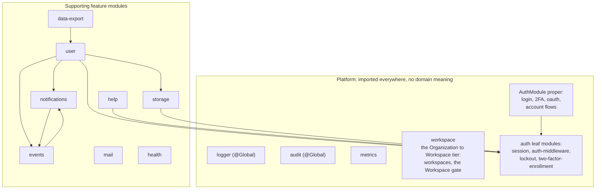
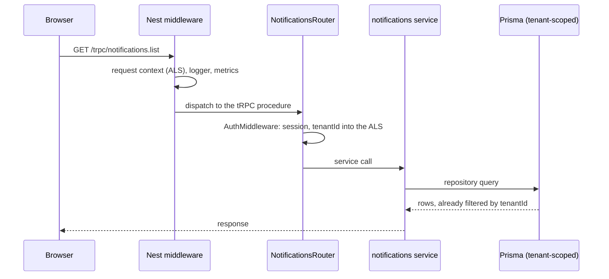

This page is for orienting: what the backend is divided into, why it divides
that way, and where a new piece of work belongs.

It is the companion to `apps/api/src/modules/README.md`, which is written for
somebody already editing a file in the module. That README owns the **file
suffix glossary** (what `.port`, `.machine`, `.rail`, `.resolver`, `.codec` and
`.contract-suite` mean, and which ones appear only once). It is the single
source of truth for the vocabulary and is deliberately not restated here, so a
new suffix is added in one place.

## The shape

`apps/api/src/modules/` holds the backend's feature and platform modules, and
the way they divide is the map worth learning first.

Every feature module also reaches `logger`, `audit` and `metrics`; those edges
are left off so the diagram stays readable.

### workspace: the tenancy tier

The workspaces of an organization, the second tier of the Organization -> Workspace
boundary: the `workspaces` router (list for every staff account, create and edit for
an ADMIN), `WorkspaceService` (the audited writes), `WorkspaceRepository` and
`WorkspaceLookupService`, the read half other modules depend on. It is platform: it
imports no feature module, so the tenancy tier stays whole in any product built
on this code. The tRPC paths are `workspaces.*`.

## Platform modules versus feature modules

**Platform** modules carry no domain meaning and are imported by nearly
everything: `logger` and `audit` (both `@Global()`, so they need no import
line), `metrics` (global in effect through the prom-client singletons in its
registry), and the `auth` leaf modules. `common/` adds `PrismaModule`,
`RedisModule` and `QueueModule`, also `@Global()`.

Everything else is a **feature**, including `AuthModule` proper.

`modules/auth` is both at once, and that is the load-bearing fact. A router
that needs `AuthMiddleware` imports `AuthMiddlewareModule`, never `AuthModule`,
because `AuthModule` pulls in login, 2FA, oauth and the account flows and
reopens a cycle. Every import of the platform half looks like an edge to the
feature half, which is why those import lines are annotated.

## How a request flows

A staff procedure such as the notification bell's listing is the ordinary path
through the stack.

A few things in that path are worth reading twice.

**The tenant filter is not in the query.** `AuthMiddleware` puts `tenantId` into
AsyncLocalStorage and a Prisma `$extends` boundary applies it. A repository does
not pass a tenant id and cannot forget to; see [Tenancy](/backend/tenancy/).

## Where new work goes

- **A new procedure on an existing domain**: a `.router` in that module. tRPC is
  the default entry point.
- **Something tRPC cannot serve** (bytes, redirects, a feed a client reaches
  with no session): a `.controller`. There are only a handful in the whole api,
  and each one has a reason recorded in its docblock.
- **A new edge to another module**: import that module's **service** through its
  module, or go through a `.port`. Never import a foreign repository, and never
  reach into a foreign subdirectory.
- **A constant or type another module needs**: add it to that module's
  `.public.ts`, so a sanctioned cross-module value reads differently in the
  import line from a reach into someone's internals.
- **A whole new domain**: a new module directory, and a read of the README's
  suffix table before naming its files.

## What lint guarantees, and what it does not

`packages/eslint-config/nestjs.js` runs a set of architecture rules at `error`
over the api. All but one are production-code only; `interface-prefix-i` also
polices specs, since a renamed interface used in a test still has to match. By
class:

- **Tenancy and transactions**: no unscoped Prisma client outside an allowlist;
  a scoped model carries `tenantId` in both `where` and `data`; no foreign
  tenant id in a `where`; every write inside a transaction, using `tx` rather
  than the outer client.
- **Queue**: processors extend `TracedWorkerHost`; `add` wraps job context; job
  names come from constants.
- **Audit, time and naming**: a mutating service writes an `AuditLog` row; no
  bare `Date.now()` in place of `common/clock`; every interface is `I`-prefixed.

Three `pnpm lint:meta` rules add to that from outside ESLint:
`routes-require-test-sibling` refuses a `*.router.ts` with no co-located
`*.router.spec.ts`, `tenant-model-registry-parity` holds the tenant-model
list in the ESLint config against `TENANT_SCOPED_MODELS` in the runtime Prisma
extension, so a model cannot get the runtime filter without the static rules or
the other way round, and `api-module-edges` resolves every relative import under
`src/modules/` against the edge rules drawn above.

`api-module-edges` holds three of them: the **direction** of the feature graph,
a **value import of a foreign `*.repository`** (a type-only one is allowed, since
it binds nothing at run time), and a **reach into a foreign subdirectory**
outside the sanctioned platform entry points (`auth/middleware`,
`auth/services`). The direction table had zero breaks when the rule landed, so
it runs with no allowance at all; the other two carry a table of the edges that
already existed, each with a written reason, and an entry whose import is gone
is itself reported.

Nothing enforces the suffix vocabulary or the platform/feature split. Those are
still convention, and only review catches a break. The README's list of the
annotated import lines is the record of why the graph is acyclic;
`grep -rn forwardRef apps/api/src` returns zero live uses, and it stays that way
by argument rather than by tooling.

## See also

- `apps/api/src/modules/README.md` for the file suffix glossary and the
  sanctioned edges in reference form.
- [Tenancy](/backend/tenancy/) for the Prisma extension the whole graph relies on.
- [End-to-End Type Safety Chain](/architecture/type-safety-chain/) for what happens to a
  `.router` after it is written.
