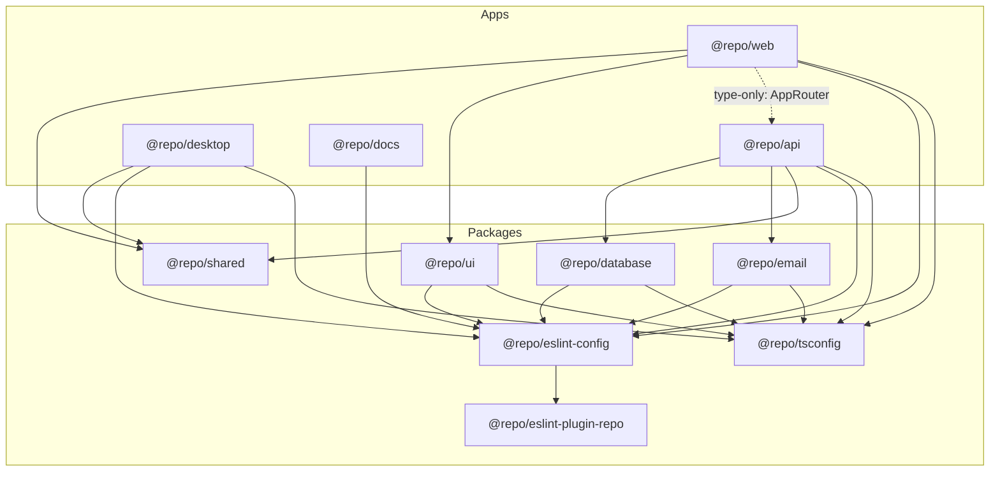

## Workspace layout

The repository is a pnpm workspace managed by Turborepo. `pnpm-workspace.yaml` declares two workspace globs:

```yaml
packages:
  - 'apps/*'
  - 'packages/*'
```

Everything under `apps/` is a top-level target: three of them are deployable applications (`api`, `web`, `desktop`) and one is a static internal site (`docs`). Everything under `packages/` is a library consumed by one or more apps. `tools/` holds standalone scripts (codegen, the internal meta-linter) that are not published packages but run via `tsx` from the root `package.json`.

```
.
├── apps/
│   ├── api/              @repo/api        NestJS 11 backend
│   ├── web/               @repo/web        Vite + React SPA
│   ├── desktop/           @repo/desktop    Electron shell wrapping the web build
│   ├── docs/              @repo/docs       Astro + Starlight: this site
├── packages/
│   ├── database/          @repo/database   Prisma 7 client, schema, migrations
│   ├── shared/             @repo/shared     zod schemas, types, constants, errors, logger, events
│   ├── email/              @repo/email      react-email templates
│   ├── ui/                 @repo/ui         shared React component library (shadcn-style)
│   ├── eslint-config/       @repo/eslint-config  flat ESLint config presets
│   ├── eslint-plugin-repo/  @repo/eslint-plugin-repo  custom ESLint rules for this repo
│   └── tsconfig/           @repo/tsconfig   shared tsconfig bases
├── tools/
│   ├── codegen/            pnpm new:feature / new:component generators
│   └── lint-meta/          custom "lint the linters/CI" meta-rule runner
└── docs/                   decisions, invariants, runbooks and operating docs
```

The package manager is pinned via `packageManager: "pnpm@10.34.9"` in the root `package.json`. Node `>=22.22.1` is required (`engines`).

## Apps

### `apps/api` (`@repo/api`)

NestJS 11 backend. Exposes:

- A tRPC API (via `nestjs-trpc`) mounted through `TRPCModule.forRoot(...)` in `apps/api/src/app.module.ts`. This is the primary contract the web and desktop clients talk to.
- REST-style controllers for things that are not tRPC-shaped: health checks (`apps/api/src/modules/health`), Prometheus metrics (`apps/api/src/modules/metrics`), CSRF token issuance (`apps/api/src/common/security`), and the web-vitals beacon endpoint.
- Socket.io gateways for realtime events (`apps/api/src/common/websocket`, `apps/api/src/modules/events`), backed by a Redis adapter so events fan out across API replicas.
- BullMQ background jobs (`apps/api/src/common/queue`, e.g. notification dispatch, retention crons).

Its modules under `apps/api/src/modules/` divide into a platform half and a feature half; see [API Module Structure](/architecture/api-module-structure/) for the shape and `apps/api/src/modules/README.md` for the file-suffix vocabulary.

Built with `nest build -b swc`. Depends on `@repo/database`, `@repo/email`, and `@repo/shared`.

### `apps/web` (`@repo/web`)

Vite + React 19 SPA. File-based routing via TanStack Router (`apps/web/src/routes/`), server state via TanStack Query + the tRPC/TanStack Query integration (`@trpc/tanstack-react-query`), local/UI state via Zustand (`apps/web/src/stores/`). Feature code lives under `apps/web/src/features/<domain>/` (see `apps/web/src/features/README.md` and `build-and-dx.md` for the enforced 8-file component folder convention). Depends on `@repo/ui` and `@repo/shared`, and consumes the generated tRPC router type from `@repo/api` (`apps/api/src/@generated/server.ts`) as a type-only import.

### `apps/desktop` (`@repo/desktop`)

Electron shell. The main process (`apps/desktop/src/main/`) hosts IPC handlers, an auto-updater (`electron-updater`, S3-backed: see `environments-and-config.md`), and `electron-store` for local settings. It loads the `apps/web` production build as its renderer (there is no separate desktop UI codebase); `apps/web/src/lib/electron.ts` detects the Electron context and resolves the API's dynamic port over IPC. Depends on `@repo/shared` only.

### `apps/docs` (`@repo/docs`)

Astro 7 + Starlight, the site you are reading. It is a static site with
no runtime dependency on any other app: it documents them in prose and re-declares
the design palette as literal hexes, which is why `pnpm check:contrast` holds that
copy against `@repo/ui`'s `globals.css`. `check-types` runs `astro sync` before
`astro check`, because the content collection types do not exist until sync has
generated them. The repo convention is that shipping a feature adds a page here.

## Packages

### `@repo/database`

Prisma 7 setup: `packages/database/prisma/schema/` (a multi-file schema folder, one `.prisma` per domain), migrations under `packages/database/prisma/migrations/`, a generated client under `packages/database/generated/prisma/` (ESM-only, driver adapter `@prisma/adapter-pg`), and a thin `src/client.ts` that constructs the pooled `PrismaClient` plus a slow-query logging `$extends` hook. See `data-layer.md` for the full picture, including the tenant-scoping extension that lives in `apps/api` (not here: this package is deliberately DB-only with no request-context awareness).

### `@repo/shared`

Framework-agnostic contracts consumed by both `apps/api` and `apps/web` (and, selectively, `apps/desktop`). Subpath exports (`package.json` `exports` map) split it into: `./schemas` (zod request/response contracts), `./types`, `./constants`, `./errors` (shared `AppErrorCode` contract), `./logger` (structured logger + redaction), `./permissions` (role constants), `./events` (Socket.io payload types), `./money`, `./audit`, `./desktop` (Electron IPC contract shapes). This is the backbone of the type-safety chain described in `type-safety-chain.md`.

### `@repo/email`

`react-email` templates, built with `tsup`. Rendered server-side by `apps/api`'s mail module.

### `@repo/ui`

Shared component library. Unlike `apps/web`'s feature folders, `@repo/ui` keeps a flat shadcn-style convention: one kebab-case file per component, each with its own subpath export in `package.json` (e.g. `@repo/ui/button` → `./src/components/button.tsx`). No build step for consumption: apps import the `.tsx` source directly (see the `exports` map), and Vite compiles it as part of the consuming app.

### `@repo/eslint-config`

Flat ESLint config presets other packages extend: `./base`, `./react`, `./react-architecture` (the feature-folder rules described in `build-and-dx.md`), `./nestjs`. Depends on `@repo/eslint-plugin-repo`.

### `@repo/eslint-plugin-repo`

The repo's own custom ESLint rules (tenancy/Prisma safety, queue conventions, frontend architecture, comment hygiene, etc.). Built with `tsup` to CJS+ESM+`.d.ts` so it can be consumed by the flat configs regardless of module system. See `build-and-dx.md`.

### `@repo/tsconfig`

Shared `tsconfig` base files only (no code, no scripts beyond `check-types` not applicable: it just ships `*.json`).

## Dependency graph



The dotted `web -> api` edge is the important one to understand: `apps/web` never imports `apps/api` at runtime. It imports the _type_ `AppRouter` from `apps/api/src/@generated/server.ts` (a file generated by `nestjs-trpc generate`, see `type-safety-chain.md`). Turborepo encodes this as an explicit task dependency (`@repo/web#check-types` and `@repo/web#build` both `dependsOn: ["@repo/api#generate:trpc"]` in `turbo.json`) even though there is no `workspace:*` dependency between the two `package.json` files.

All workspace packages declare their internal dependencies with `"workspace:*"` in `package.json` (e.g. `apps/api/package.json` has `"@repo/database": "workspace:*"`), which pnpm resolves to a symlink into the workspace rather than a registry install.
