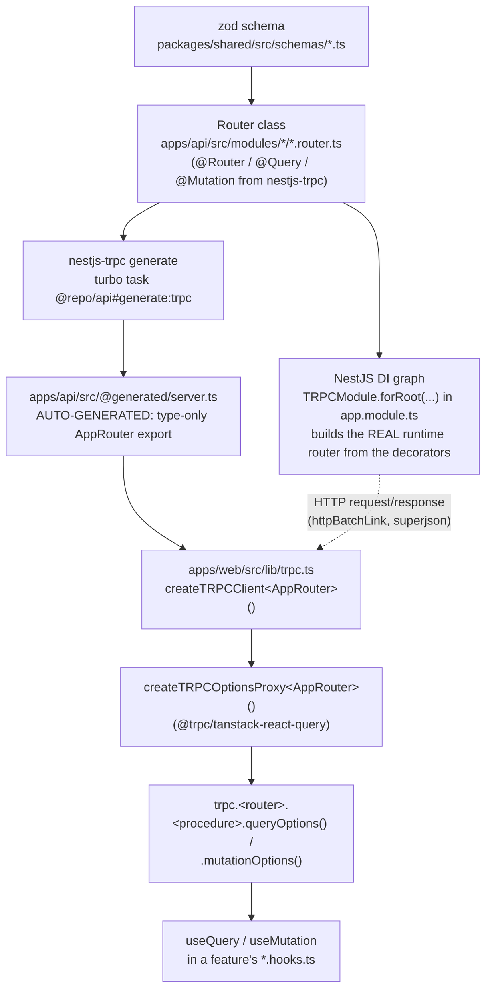

## The chain at a glance



Two things to notice up front:

1. **The generated file is types-only at runtime.** `apps/api/src/@generated/server.ts` is produced by `nestjs-trpc generate` and its procedure bodies are literally `async () => "PLACEHOLDER_DO_NOT_REMOVE" as any`. The web app only ever imports `type { AppRouter }` from it: it is never executed. The _real_ runtime router is built by `nestjs-trpc`'s own `TRPCModule` from the `@Router`/`@Query`/`@Mutation` decorators at Nest bootstrap time, wired through the normal NestJS DI graph (constructor-injected services). The generated file exists purely so the web/desktop TypeScript compiler has a concrete `AppRouter` type to infer against, without either app depending on the other's `node_modules`.
2. **`zod` schemas in `@repo/shared` are the single source of truth for shape.** The same schema object is used as the tRPC `input:`/`output:` validator on the server (enforced at runtime) and, via `z.infer<>`, as the TypeScript type the client sees. There is no separate "DTO" layer to keep in sync by hand.

## Step by step: how a new procedure flows through the stack

Concrete example: `user.me`, which returns the authenticated user's profile.

### 1. Define the contract in `@repo/shared`

`packages/shared/src/schemas/user.ts`:

```ts
export const userProfileOutput = z.object({
  id: z.string(),
  email: z.string(),
  displayName: z.string().nullable(),
  avatarUrl: z.string().nullable(),
  role: z.string(),
  emailVerified: z.boolean(),
  createdAt: z.date(),
});
export type UserProfileOutput = z.infer<typeof userProfileOutput>;
```

This is exported through the package's `./schemas` subpath (`packages/shared/package.json`'s `exports` map), re-exported from `packages/shared/src/schemas/index.ts`.

### 2. Wire it into a router on the API

`apps/api/src/modules/user/user.router.ts`:

```ts
@Router({ alias: 'user' })
@UseMiddlewares(AuthMiddleware)
export class UserRouter {
  constructor(private readonly userService: UserService, ...) {}

  @Query({ output: userProfileOutput })
  async me(@Ctx() ctx: IAuthenticatedContextType) {
    return this.userService.getProfile(ctx.user.id);
  }
  ...
}
```

Every procedure **must** declare an `output:` schema: without one, `nestjs-trpc` falls back to `as any` in the generated file, which silently poisons every downstream type. `input:` is only declared for mutations/queries that take arguments (see `updateAvatarInputSchema` in the same file for a `z.object(...)` built inline from `@repo/shared` primitives like `avatarKeySchema`). `@UseMiddlewares(AuthMiddleware)` at the class level gates every method; `IAuthenticatedContextType` (from `apps/api/src/trpc/trpc.context.ts`) narrows `ctx.user`/`ctx.session` to non-null so the handler never needs a `ctx.user!` assertion.

`UserRouter` is registered as a provider in `apps/api/src/modules/user/user.module.ts`, and the module is imported into `apps/api/src/app.module.ts`. `TRPCModule.forRoot({...})` (also in `app.module.ts`) discovers every `@Router`-decorated class in the DI graph and builds the live tRPC router from them: this is the actual code path a real request executes, independent of code generation.

### 3. Generate the client-facing router type

`turbo.json`'s `@repo/api#generate:trpc` task runs `nestjs-trpc generate` (the API's own `generate:trpc` script), which statically scans the same decorated router classes and emits `apps/api/src/@generated/server.ts`:

```ts
const appRouter = t.router({
  user: t.router({
    me: publicProcedure.output(userProfileOutput).query(async () => "PLACEHOLDER_DO_NOT_REMOVE" as any),
    ...
  }),
  ...
});
export type AppRouter = typeof appRouter;
```

This task is cached by Turbo and keyed on every `apps/api/src/**/*.ts` file except the generated output itself (`turbo.json`), so any router or schema change invalidates it. It is a hard dependency of `@repo/api#build`, `@repo/web#build`, both apps' `check-types` tasks, and `@repo/web#lint`: the web app cannot type-check or build without a fresh `AppRouter`.

### 4. Consume it from the web client

`apps/web/src/lib/trpc.ts` builds the client once, lazily (Electron needs to resolve its dynamic backend port first):

```ts
_trpcClient = createTRPCClient<AppRouter>({
  links: [
    httpBatchLink({
      url: getTrpcUrl(),
      transformer: superjson, // must match TRPCModule.forRoot's transformer
      async headers() {
        return { [CSRF_HEADER]: await getCsrfToken() };
      },
      fetch(url, options) {
        return fetchWithCsrfRetry(url, options);
      },
    }),
  ],
});
_trpc = createTRPCOptionsProxy<AppRouter>({ client: _trpcClient, queryClient });
```

`createTRPCOptionsProxy` (from `@trpc/tanstack-react-query`) is what turns the raw tRPC client into `trpc.user.me.queryOptions()` / `trpc.user.updateAvatar.mutationOptions()`: TanStack Query option objects with fully-inferred input/output types and a canonical query key, without hand-writing either.

### 5. Use it in a feature hook

Per the component-folder convention (`build-and-dx.md`), all query/mutation usage lives in a component's `*.hooks.ts`, never in the `.tsx` shell. Real example, `apps/web/src/features/notifications/components/NotificationBell/NotificationBell.hooks.ts`:

```ts
const { data } = useQuery(trpc.notifications.list.queryOptions({}));

const markAllReadMutation = useMutation(
  trpc.notifications.markAllRead.mutationOptions({
    onMutate: async () => {
      const queryKey = trpc.notifications.list.queryKey({});
      await queryClient.cancelQueries({ queryKey });
      const previous = queryClient.getQueryData(queryKey);
      if (previous) queryClient.setQueryData(queryKey, { ...optimistic update... });
      return { previous };
    },
    onError: (_e, _v, context) => { if (context?.previous) queryClient.setQueryData(...); },
    onSettled: () => { void queryClient.invalidateQueries(trpc.notifications.list.pathFilter()); },
  }),
);
```

The query key, the input type, and the resolved output type (`data.items`, `data.unreadCount`) all flow from step 1's zod schema through steps 2-4 with no manual casting anywhere in this file.

Invalidate, refetch, cancel, remove and reset a procedure by its path (`pathKey()` / `pathFilter()`), never by a bare `queryKey()` / `queryFilter()`. An input-less `queryKey()` is `[path, { type: 'query' }]`, which prefix-matches no infinite query, so the call silently stops working the day the procedure moves to `useInfiniteQuery`; `pathKey()` is `[path]` and reaches every entry. The `repo/trpc-invalidate-with-path-key` ESLint rule enforces it with an autofix. Keys with an input (`queryKey({ id })`, used with `setQueryData`) address one entry and stay as they are. `pnpm new:feature` / `pnpm new:component` (see `build-and-dx.md`) scaffold this exact pattern for a new feature so nobody hand-writes a query key from scratch.

## Transformer and header contract

Both sides must agree on the wire transformer: `TRPCModule.forRoot({ transformer: superjson, ... })` in `apps/api/src/app.module.ts` and `httpBatchLink({ transformer: superjson, ... })` in `apps/web/src/lib/trpc.ts`: `superjson` is what lets `Date`, `Map`, `Set`, `BigInt`, and `Decimal` survive the JSON boundary intact (e.g. `userProfileOutput.createdAt` stays a real `Date` on the client, not an ISO string that needs re-parsing).

Every outgoing request also carries a CSRF header (`CSRF_HEADER` from `@repo/shared/constants`), fetched via `getCsrfToken()`/`fetchWithCsrfRetry` (`apps/web/src/lib/csrf.ts`): the double-submit cookie pattern the API's `CsrfService` (`apps/api/src/common/security`) validates on every non-exempt request (see `apps/api/src/main.ts`).

## Error contract

`apps/api/src/trpc/trpc.error-handler.ts` defines `appErrorFormatter`, wired into `TRPCModule.forRoot({ errorFormatter: appErrorFormatter, ... })`. It puts a canonical `AppErrorCode` (from `@repo/shared/errors`) onto `error.data.appCode` on the wire, so the web client can branch on a structured code instead of matching against error message substrings. `apps/web/src/lib/trpc-errors.ts` and the `isUnauthorizedError` helper in `apps/web/src/lib/trpc.ts` (checking `error.data.code === 'UNAUTHORIZED'` or `httpStatus === 401`) consume this. The global `QueryCache` in `apps/web/src/lib/trpc.ts` centralizes error side effects: 401s are left to routing (redirect to login), background refetch failures toast, and initial-load failures are left to the route/component's own error state.

## Realtime supplement (outside tRPC)

Not every server-to-client signal goes through tRPC. `apps/api/src/modules/events` and `apps/api/src/common/websocket` run a Socket.io gateway (Redis-adapter-backed for multi-replica fan-out); its payload shapes are typed via `@repo/shared/events` (e.g. `NotificationPayload`) rather than zod-validated at the transport layer. The Notification feature is the reference pattern: Postgres (via `notifications.list`) is the source of truth for the bell, and Socket.io events are delivery-only: the dispatch worker persists the row first, then emits, so a page refresh always rehydrates via tRPC to exactly what was pushed live. See `apps/web/src/lib/socket.ts` and `data-layer.md`'s Redis section for the pub/sub mechanics.
