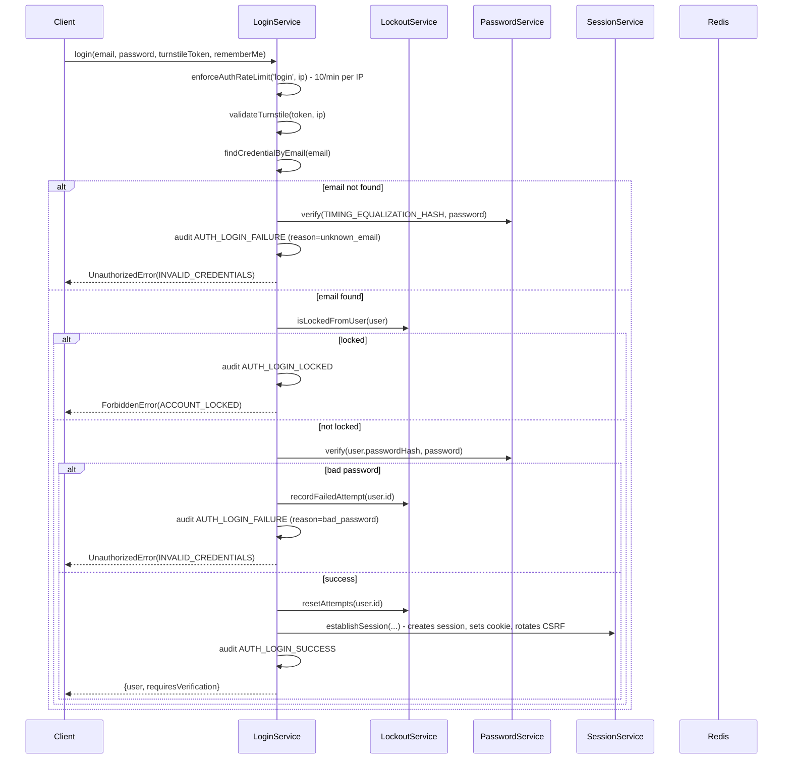

## Overview

The API uses server-side sessions, not JWTs. On login the server mints a random token, stores session data in Redis keyed by a hash of that token, and hands the raw token to the browser as an `httpOnly` cookie. Every subsequent request is authenticated by looking up that hash in Redis.

Core files:

- `apps/api/src/modules/auth/services/session.service.ts` - session storage in Redis
- `apps/api/src/modules/auth/services/auth-shared.service.ts` - cookie writer, session establishment, per-IP rate limiting
- `apps/api/src/modules/auth/services/login.service.ts`, `register.service.ts`, `password-reset.service.ts`, `email-verification.service.ts`, `password-change.service.ts` - the individual flows
- `apps/api/src/modules/auth/services/lockout.service.ts` + `repositories/lockout.repository.ts` - brute-force lockout
- `apps/api/src/modules/auth/services/password.service.ts` - password hashing
- `apps/api/src/common/security/csrf.service.ts` + `csrf.controller.ts` - CSRF double-submit protection
- `apps/api/src/modules/auth/auth.router.ts` - the tRPC surface
- `apps/api/src/modules/auth/middleware/auth.middleware.ts`, `role.middleware.ts`, `permission.middleware.ts` - request-time guards
- `apps/api/src/modules/events/session-revocation.service.ts` - shared teardown for logout / role change / deletion
- `packages/shared/src/schemas/auth.ts` - the zod input/output contracts

> **Correction to a common assumption**: password hashing in this codebase is **Argon2id** (`@node-rs/argon2`), not Scrypt. There is no `scrypt` reference anywhere in `apps/api/src`. If you inherited documentation or memory claiming Scrypt, treat this file as the source of truth.

## Password hashing

`apps/api/src/modules/auth/services/password.service.ts` hashes with Argon2id, OWASP-recommended parameters:

```ts
export const ARGON2_OPTIONS = {
  algorithm: ARGON2ID, // 2
  memoryCost: 19456, // 19 MiB (OWASP minimum)
  timeCost: 2,
  parallelism: 1,
} as const;
```

The password is normalized to NFC before hashing/verifying so the same visual password produces the same hash regardless of input source (iOS often emits NFD, desktop NFC). `verify()` returns `false` on any error instead of throwing (a corrupt hash format is treated as "wrong password", not a crash).

`login.service.ts` keeps a pre-baked Argon2id hash of a throwaway string (`TIMING_EQUALIZATION_HASH`, same tuning parameters) that it verifies against on the unknown-email branch, so an attacker cannot use response timing to tell whether an email exists. A spec asserts the encoded hash stays in sync with `ARGON2_OPTIONS`.

## Session storage

Sessions live entirely in Redis. Key formats (`apps/api/src/common/redis/redis-keys.ts`):

| Key                              | Contents                                                                                              |
| -------------------------------- | ----------------------------------------------------------------------------------------------------- |
| `session:<sha256(token)>`        | Full `ISessionData` JSON blob                                                                         |
| `user_sessions:<userId>`         | SET of session IDs owned by the user (used for revocation and eviction)                               |
| `session_epoch:<userId>`         | Revocation counter, INCR'd by every revoke-all (see [the fence](#the-session-epoch-fence))            |
| `permissions:<userId>:<role>`    | Cached effective-permission list, TTL 300s                                                            |
| `ratelimit:<scope>`              | Fixed-window rate-limit counter                                                                       |
| `idem:<scope>:<path>:<bodyHash>` | Idempotency cache (see [error-contract-and-idempotency.md](/backend/error-contract-and-idempotency/)) |

`SessionService.createSession()` (`apps/api/src/modules/auth/services/session.service.ts`):

1. Mints `randomBytes(32).toString('hex')` as the raw token (32 bytes = 256 bits of entropy).
2. Derives `sessionId = sha256Hex(token)`. Only the hash is stored server-side; the raw token lives only in the cookie, so a compromised Redis dump cannot be replayed as a valid session.
3. TTL is **24 hours** by default, or **30 days** if `rememberMe` was set at login.
4. Writes membership (`SADD user_sessions:<uid>`) and the blob (`SETEX session:<sid>`) in a single Redis `MULTI`, so a crash between the two writes can't happen.
5. Stamps the caller's captured **session epoch** into the blob and re-checks it after the write, refusing the mint if a revocation raced it (see [the fence](#the-session-epoch-fence)).
6. Enforces **max 3 concurrent sessions per user** (`MAX_SESSIONS = 3`), evicting the oldest session, checked _after_ the write so concurrent logins converge instead of overshooting.

The stored `ISessionData` blob:

```ts
interface ISessionData {
  userId: string;
  email: string;
  role: string;
  emailVerified: boolean;
  ip: string;
  userAgent: string;
  createdAt: number;
  lastActive: number;
  expiresAt: number;
  epoch: number; // revocation fence, see below
  tenantId?: string; // present once the user belongs to a Tenant (Organization)
}
```

It is validated with a zod schema on every read (`sessionDataSchema`); a corrupt or manually-edited Redis entry is treated as "no session" rather than crashing downstream. `validateSession()` compares the blob's `epoch` against `session_epoch:<userId>` (the fence, below) and then refreshes `lastActive` at most once per 60 seconds using `SET ... KEEPTTL XX` (an atomic update-if-exists that never resurrects a session revoked between the read and the write). Both the tRPC `AuthMiddleware` and the WebSocket handshake authenticate through this one method, so both inherit the fence.

`deleteSession()` (single logout) and `deleteAllUserSessions()` (logout-all-devices) both remove from the `user_sessions` SET and delete the blob; only the second bumps the epoch.

## Cookies

Cookie name resolution lives in `apps/api/src/modules/auth/auth.constants.ts`:

```ts
const SESSION_COOKIE_BASE_NAME = 'session_id';
export function getSessionCookieName(isProduction: boolean): string {
  return isProduction ? `__Host-${SESSION_COOKIE_BASE_NAME}` : SESSION_COOKIE_BASE_NAME;
}
```

In production the cookie carries the `__Host-` prefix, which the browser only accepts on a `Secure`, `Path=/`, no-`Domain` cookie - this binds the cookie to the exact host and blocks a subdomain (or an http origin) from setting or overwriting it.

### The SameSite split

`AuthSharedService.setSessionCookie()` (`apps/api/src/modules/auth/services/auth-shared.service.ts`) sets `sameSite` differently depending on **who is asking**, in production only:

```ts
private resolveSameSite(req: Request): 'none' | 'lax' {
  if (!this.isProduction) return 'lax';
  return req.headers.origin === DESKTOP_APP_ORIGIN ? 'none' : 'lax';
}
```

- The packaged Electron desktop app calls the API from the cross-site `app://app` origin, so its session cookie must be `SameSite=None` to ride along at all.
- The web SPA is same-origin, so it gets the stricter `Lax`, which removes the cookie from cross-site POSTs entirely (defense in depth on top of the CSRF double-submit token).
- Dev is always `Lax` (both clients talk to plain http localhost, where `None` would require `Secure`).

`clearSessionCookie()` is deterministic rather than per-origin: production always clears with `SameSite=None` (a Lax/Strict `Set-Cookie` is dropped on a cross-site response, which would leave the desktop origin unable to clear its own cookie on logout).

The **CSRF token cookie** uses a separate, static SameSite policy (`sameSite: isProduction ? 'none' : 'lax'`, fixed at construction) because one `doubleCsrf` instance serves both the web and desktop origins and can't vary its cookie options per request the way the session cookie writer can.

## Login flow

`LoginService.login()` (`apps/api/src/modules/auth/services/login.service.ts`):



Note the response never leaks whether the email exists: the unknown-email branch still pays the Argon2 verify cost, and both failure branches throw the same `UnauthorizedError(INVALID_CREDENTIALS)`.

`establishSession()` is the single shared path used by login, register, and password change: it creates the Redis session, sets the cookie, and rotates the CSRF token (a token issued before the auth state change would otherwise remain valid afterward, a session-fixation hole).

## Account lockout

`apps/api/src/modules/auth/services/lockout.service.ts`:

- `MAX_FAILED_ATTEMPTS = 5` before a lockout is applied.
- Progressive lockout durations, keyed by how many times the account has been locked before:

  | Lockout # | Duration                                        |
  | --------- | ----------------------------------------------- |
  | 1st       | 5 minutes                                       |
  | 2nd       | 15 minutes                                      |
  | 3rd       | 1 hour                                          |
  | 4th+      | permanent (`9999-12-31`), requires admin unlock |

- `resetAttempts()` on successful login clears `failedAttempts` but **not** `lockoutCount` - the escalation persists across separate lockout episodes.
- `adminUnlock()` is tenant-scoped: it reads the caller's tenant from the AsyncLocalStorage context and fails closed (`ForbiddenError`) if no tenant is present, so an admin in one Organization can never unlock a user in another.
- `LockoutRepository.applyLockout()` guards its write (`OR: [{lockedUntil: null}, {lockedUntil: {lt: now}}]`) so a burst of concurrent failed attempts can't multi-increment `lockoutCount` past one tier at a time.

## Registration (self-signup)

`RegisterService.register()` (`apps/api/src/modules/auth/services/register.service.ts`):

1. Rate limit + Turnstile validation (same as login).
2. Disposable-email check, then existing-email check.
3. Hash the password.
4. `runRegistrationTransaction()` runs one Prisma transaction that creates a `Tenant` row (the Organization) with `slug = <email-local-part>-<8 hex chars>`, then creates the `User` row with `role: ADMIN` and `tenantId: tenant.id`. **The self-signup owner is always minted as the tenant's ADMIN.** A verification token is minted in the same transaction. See [tenancy.md](/backend/tenancy/) for the full tenant model.
5. `finalizeRegistration()` enqueues the verification email (failure is tolerated and reported back as `emailSent: false`, see [mail.md](/backend/mail/)), calls `establishSession()` (an unverified user can still log in), and audits `AUTH_REGISTER_SUCCESS`.

Input contract (`registerSchema` in `packages/shared/src/schemas/auth.ts`): `email`, `password` (complexity-checked: 8+ chars, uppercase, lowercase, number, special character), `displayName?` (max 100 chars), `turnstileToken`.

## Password reset and email verification

**Forgot / reset password** (`password-reset.service.ts`):

- `forgotPassword()` is rate-limited and Turnstile-checked, but **always returns success** even for an unknown email (anti-enumeration). It still audits `AUTH_PASSWORD_FORGOT` with `reason: unknown_email` server-side.
- Reset token TTL is **1 hour** (`PASSWORD_RESET_TOKEN_TTL_MS`).
- `resetPassword()` validates the token **before** the expensive Argon2 hash (a DoS guard against hashing junk passwords for invalid tokens), consumes the token and updates the password in one transaction, then calls `sessionRevocation.revokeAllAndDisconnect(userId)` - every session and live socket for that user is dropped, forcing a fresh login everywhere.

**Email verification** (`email-verification.service.ts`):

- Verification token TTL is **24 hours** (`VERIFICATION_TOKEN_TTL_MS`).
- `verifyEmail()` consumes the token and flips `emailVerified` in one transaction, then sends the welcome email.
- `resendVerification()` is rate-limited to **3 requests per hour per user** via Redis (a DB count won't work here since creating a new token deletes the prior row).

Expired tokens of both types (`EMAIL_VERIFICATION`, `PASSWORD_RESET`) are swept hourly by `TokenCleanupService` - see [background-jobs.md](/backend/background-jobs/).

**Password change** (authenticated, `password-change.service.ts`): verifies the current password, writes the new hash and invalidates outstanding reset tokens in one transaction, revokes every session, then re-establishes a fresh session so the caller stays logged in on their current device.

## CSRF protection

`apps/api/src/common/security/csrf.service.ts` implements double-submit cookie CSRF via the `csrf-csrf` library.

Two cookies are involved:

- **Pre-session identity**: `__Host-csrf-sid` (prod) / `csrf-sid` (dev). Set by `ensureSessionIdentifier` before any login session exists, so even an anonymous visitor has a stable identity to hash tokens against. `httpOnly`, `sameSite: 'strict'`, no `maxAge` (dies with the browser session).
- **CSRF token**: `__Host-csrf-token` (prod) / `csrf-token` (dev). `httpOnly`, `secure: isProduction`, static `sameSite: isProduction ? 'none' : 'lax'`.

The token itself travels in the `x-csrf-token` request header (`CSRF_HEADER` in `packages/shared/src/constants`), never in the request body.

`protect` middleware passes `GET/HEAD/OPTIONS` through untouched; other methods go through `doubleCsrfProtection`. On failure it returns an **explicit 403** with a structured body (`{ error: { message: 'Invalid CSRF token', code: 403 } }`) rather than letting the library's raw error escape to Express's default handler (which would otherwise produce a bare 500, since a pre-router Express middleware error doesn't pass through Nest's `AllExceptionsFilter`).

`rotate()` forces a fresh token (`overwrite: true`) after login, register, logout, logoutAll, and password change.

Wiring (`apps/api/src/main.ts`): cookie parser first, then for every request except the exempted `/api/vitals` path (the `navigator.sendBeacon` POST that can't carry a custom header), `ensureSessionIdentifier` then `protect` run in sequence. `GET /api/csrf-token` is served by `CsrfController` (a real Nest HTTP controller, throttled at **30 requests/minute per IP**), not registered directly on the raw Express app, so the global `ThrottlerGuard` actually applies to it.

### Two CSRF pitfalls the wiring avoids

1. The `/api/vitals` beacon could race `ensureSessionIdentifier`, clobbering the sid cookie the login page had already cached a CSRF token against. `main.ts` therefore gates `/api/vitals` out of _both_ sid-cookie creation and CSRF protection (the code comment there explains why the ordering is load-bearing).
2. A CSRF rejection that escaped as HTTP 500 instead of 403 would stop the web client's self-heal retry (which only fires on 403). `csrf.service.ts`'s `protect` middleware explicitly translates any `doubleCsrfProtection` rejection into a 403 with the app's error envelope.

Keep both properties when changing `apps/api/src/main.ts` or `apps/api/src/common/security/csrf.service.ts`.

## Rate limiting

Two independent layers exist, with no cross-wiring between them:

1. **NestJS `ThrottlerModule`** (`apps/api/src/app.module.ts`), Redis-backed via `ThrottlerStorageRedisService`, global default `{ ttl: 60000, limit: 100 }` (100 requests/minute), registered as an `APP_GUARD`. This **only covers real Nest HTTP controllers** (`CsrfController`, `VitalsController`, health checks). **tRPC procedures sit entirely outside it** - this is documented inline at several call sites (`account-deletion.service.ts`, `email-verification.service.ts`, `password-reset.service.ts`, `data-export.router.ts`).
2. **A custom Redis fixed-window limiter** for tRPC/auth flows, `AuthSharedService.enforceRateLimit(scope, limit, windowSeconds)`: an atomic `INCR` + `EXPIRE NX` in one `MULTI`, so the TTL only ever arms once and can't be reset by a subsequent hit.

Concrete limits from the custom limiter:

| Scope                                                                             | Limit                    |
| --------------------------------------------------------------------------------- | ------------------------ |
| `login`, `register`, `forgot-password`, `reset-password`, `verify-email` (per IP) | 10 requests / 60 seconds |
| `resendVerification` (per user)                                                   | 3 requests / hour        |
| `deleteAccount` (per user)                                                        | 5 requests / 15 minutes  |
| `GET /api/csrf-token` (per IP, Nest `@Throttle`)                                  | 30 requests / minute     |

No tRPC procedure carries a `@Throttle` decorator (that decorator only works on Nest HTTP controllers). Account lockout (above) is the only per-account brute-force defense for login itself; the per-IP limiter above is what blunts credential stuffing and reset-email bombing from a single source rotating email addresses.

## Session revocation on role change

Revocation is **direct**, not pub/sub: `apps/api/src/modules/user/user.service.ts`'s `revokeAuthState(userId)` calls `SessionRevocationService.revokeAllAndDisconnect(userId)` (`apps/api/src/modules/events/session-revocation.service.ts`), which deletes every Redis session for the user and force-disconnects any live Socket.io connections, **then** clears every role-keyed permission-cache entry (`permissions:<userId>:<role>` for every possible role).

The ordering (revoke sessions first, then clear the cache) is deliberate: doing it the other way round leaves a window where an in-flight request on the old role could rebuild and repoison the permission cache between the two steps. The permission cache key itself includes the role (not just the user id) specifically so a still-valid session on the _old_ role can never read a cache entry rebuilt for the _new_ role.

This same `revokeAuthState` / `revokeAllAndDisconnect` path is reused by: logout-all, password change, password reset, self-service account deletion, and admin user deletion. See [users-and-account-lifecycle.md](/backend/users-and-account-lifecycle/) for the deletion angle and [tenancy.md](/backend/tenancy/) for how role changes are scoped to the caller's own tenant.

## The session-epoch fence

Deleting sessions by walking `user_sessions:<userId>` can only delete the sessions the walk can **see**. A login running concurrently with the walk adds its session after the `SMEMBERS`, so the revocation completes and the new session survives it. Worse, a naive walk that finishes with a `DEL` of the SET removes the index entry but not the blob, so the survivor becomes an orphan no later revocation can find. The epoch fence designs that race out.

The mechanism is three parts:

1. **`session_epoch:<userId>`** is a monotonic counter. `SessionService.deleteAllUserSessions()` INCRs it **before** it walks, and the walk now `SREM`s the ids it actually read instead of `DEL`-ing the whole SET.
2. **Every session blob carries the epoch** the login captured. `createSession()` stamps it, then re-reads the counter and rolls the mint back with `SESSION_EXPIRED` if it moved.
3. **`validateSession()` compares** blob epoch against the current counter and returns null on any mismatch.

So a revocation invalidates every session minted before it whether or not the walk found it, and even if the process died halfway through the walk (the bump lands first, so a crash fails closed).

### Where the epoch is captured

The counter has to be read **before** the state that authenticates the login is read, not at mint time - otherwise the entire Argon2 verify (~100 ms) is a window in which a login that already read the pre-change password hash can still mint a session that outlives the change. `LoginService` therefore reads it immediately after the credential row and passes it through `beginOrEstablish` -> `establishSession` -> `createSession`; when a second factor is required it rides inside the pending-challenge record, so a revocation during the (up-to-300 s) challenge also invalidates the verify.

Two flows deliberately pass **no** epoch and let `createSession` read the current one: `register.service.ts` (the account did not exist when the request started) and `password-change.service.ts` (it performs the revocation itself and then re-issues, so the post-bump value is the correct one).

Residual window, stated honestly: the credential row read and the epoch read are two separate round trips, so an interleaving that lands a revocation's DB commit and its epoch bump strictly between them would not be fenced. Closing that last gap would require the counter to live on the user row and be bumped inside the same transaction as the password write, which would put a database read on every authenticated request. The remaining gap is sub-millisecond with no CPU-bound work inside it, versus the 50-100 ms it replaces.

### What bumps the epoch, and what does not

| Event                                               | Bumps? |                                                                 |
| --------------------------------------------------- | ------ | --------------------------------------------------------------- |
| Password change (`password-change.service.ts`)      | yes    | via `revokeAllAndDisconnect`                                    |
| Password reset (`password-reset.service.ts`)        | yes    | "                                                               |
| Logout all devices (`login.service.ts` `logoutAll`) | yes    | "                                                               |
| Role change (`user.service.ts` `revokeAuthState`)   | yes    | "                                                               |
| Account deletion (self-service and admin)           | yes    | " (both route through `revokeAuthState`)                        |
| 2FA admin reset (`two-factor-policy.service.ts`)    | yes    | "                                                               |
| 2FA enforcement sweep (`two-factor-enforcement.*`)  | yes    | "                                                               |
| Single-device logout (`deleteSession`)              | **no** | the counter is per-user; bumping it would sign every device out |
| `MAX_SESSIONS` eviction                             | **no** | not a revocation; the evicted blob is deleted directly          |
| 2FA enable/disable by the user                      | **no** | re-issues the current session rather than revoking all          |

Blobs written before the fence shipped have no `epoch` field, read as 0, and match the (absent) counter - so the deploy does not log the fleet out. The first revocation on an account fences them exactly like a stamped blob.

## Roles and permissions

- **Role gate**: `AdminMiddleware` (`apps/api/src/modules/auth/middleware/role.middleware.ts`) throws `ForbiddenError` unless `user.role === 'ADMIN'`. This is the middleware actually wired onto `user.router.ts`'s admin-only procedures.
- **Permission system**: `PermissionMiddleware` (`apps/api/src/modules/auth/middleware/permission.middleware.ts`) is a Redis-cached (TTL 300s), finer-grained system on top of roles - it queries the `RolePermission` table with `OR: [{role, userId: null}, {userId}]`, i.e. permissions can be granted globally per-role _or_ as a per-user override. A `ManageUsersMiddleware extends PermissionMiddleware` class exists but is not currently wired onto any router; role-gating via `AdminMiddleware` is what's actually enforced today.
- `Role` holds `USER` and `ADMIN` (`packages/database/prisma/schema/identity.prisma`). There is no `OWNER` or `SUPERADMIN`.
- `packages/shared/src/permissions/index.ts` defines `PERMISSIONS` (`MANAGE_USERS`, `MANAGE_ROLES`, `VIEW_ADMIN_PANEL`, `MANAGE_SETTINGS`, `VIEW_AUDIT_LOG`) and `DEFAULT_ROLE_PERMISSIONS` (`ADMIN` gets all five, `USER` gets none). The self-signup owner's ADMIN power comes from a **global seeded role-level grant** (`role: ADMIN, userId: null`), not a per-user row, specifically so a later role downgrade fully strips admin power (see `register.service.ts` comment around line 150).

## `auth.router.ts` procedure inventory

| Procedure            | Type     | Input schema               | Output                 | Guard                                      | Notes                               |
| -------------------- | -------- | -------------------------- | ---------------------- | ------------------------------------------ | ----------------------------------- |
| `register`           | Mutation | `registerSchema`           | -                      | public                                     | rate-limited + Turnstile internally |
| `login`              | Mutation | `loginSchema`              | -                      | public                                     | rate-limited + Turnstile internally |
| `forgotPassword`     | Mutation | `forgotPasswordSchema`     | `authAckOutput`        | public                                     | anti-enumeration, always succeeds   |
| `resetPassword`      | Mutation | `resetPasswordSchema`      | `authAckOutput`        | public                                     | rate-limited                        |
| `verifyEmail`        | Mutation | `verifyEmailSchema`        | `authAckOutput`        | public                                     | rate-limited                        |
| `logout`             | Mutation | -                          | `authAckOutput`        | `AuthMiddleware`                           |                                     |
| `logoutAll`          | Mutation | -                          | `authAckOutput`        | `AuthMiddleware`                           |                                     |
| `resendVerification` | Mutation | `resendVerificationSchema` | `authAckOutput`        | `AuthMiddleware`                           | 3/hour/user                         |
| `changePassword`     | Mutation | `changePasswordSchema`     | `authAckOutput`        | `AuthMiddleware` + `IdempotencyMiddleware` |                                     |
| `deleteAccount`      | Mutation | `deleteAccountSchema`      | `accountDeletedOutput` | `AuthMiddleware` + `IdempotencyMiddleware` | 5/15min/user                        |

`authAckOutput = { success: literal(true) }` and `accountDeletedOutput = { deleted: literal(true) }` are set as the procedure `output:` schema so the server zod-strips the wire response down to exactly that literal shape; nothing internal can leak through a wider return value.

## Modifying this area

- Adding a new auth-adjacent flow (e.g. magic-link login, OAuth): follow the `AuthSharedService.enforceAuthRateLimit` + Turnstile + `establishSession()` pattern used by every existing flow rather than hand-rolling cookie/session code, route it through `TwoFactorChallengeService.beginOrEstablish`, and capture `sessionService.readEpoch(userId)` **before** you read whatever authenticates the user. Both are lint-meta-enforced (`establish-session-callers`, `session-epoch-captured`).
- Changing session TTLs or `MAX_SESSIONS`: edit the constants at the top of `session.service.ts`; there is no env var for these today.
- Changing lockout thresholds: edit `MAX_FAILED_ATTEMPTS` / `LOCKOUT_DURATIONS_MS` in `lockout.service.ts`.
- Adding a new CSRF-exempt route: add it to the `CSRF_EXEMPT` set in `main.ts`, and re-read the comment there about why the sid-cookie exemption must be paired with the CSRF exemption.
- Running the auth test suite: `pnpm --filter @repo/api test -- auth` (Jest, fully mocked Redis/Prisma, no live services needed).
