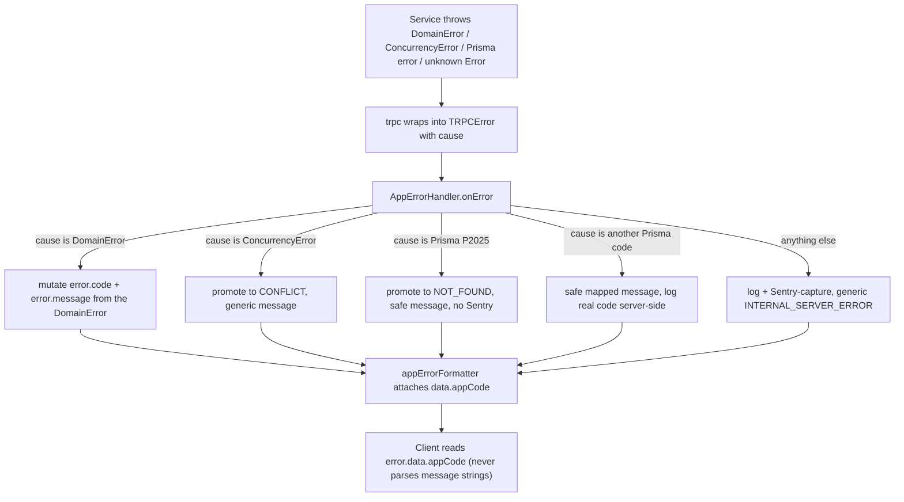
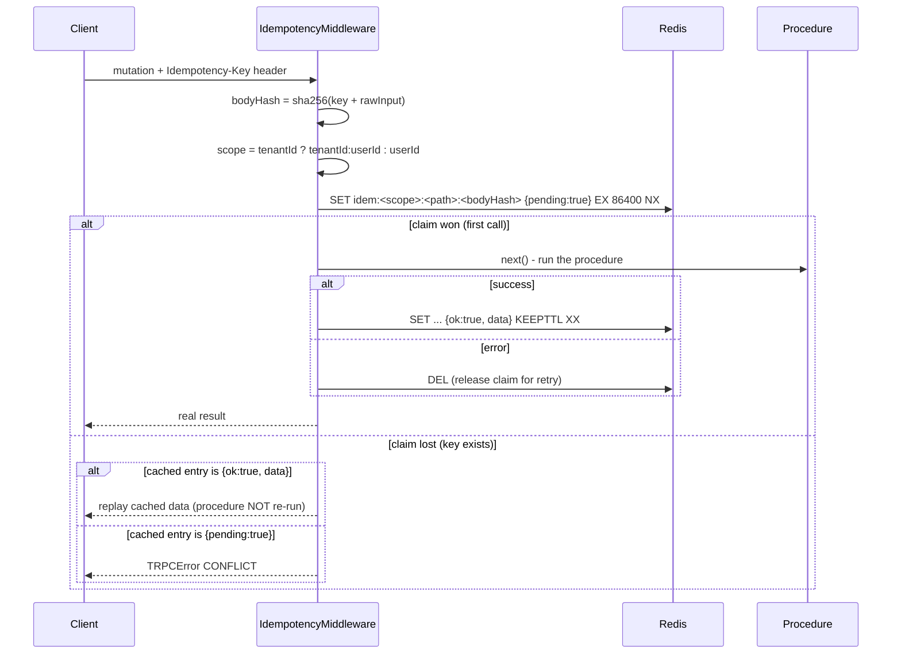

## The `AppErrorCode` contract

`packages/shared/src/errors/codes.ts` - the canonical, client-facing error code enum, shared between `apps/api` and `apps/web`:

```ts
export const AppErrorCode = {
  VALIDATION_ERROR: 'VALIDATION_ERROR',
  NOT_FOUND: 'NOT_FOUND',
  ALREADY_EXISTS: 'ALREADY_EXISTS',
  RATE_LIMITED: 'RATE_LIMITED',
  UNAUTHORIZED: 'UNAUTHORIZED',
  FORBIDDEN: 'FORBIDDEN',
  INTERNAL_ERROR: 'INTERNAL_ERROR',
  CONFLICT: 'CONFLICT',
  PAYLOAD_TOO_LARGE: 'PAYLOAD_TOO_LARGE',
  // Auth-specific
  ACCOUNT_LOCKED: 'ACCOUNT_LOCKED',
  INVALID_CREDENTIALS: 'INVALID_CREDENTIALS',
  EMAIL_NOT_VERIFIED: 'EMAIL_NOT_VERIFIED',
  INVALID_TOKEN: 'INVALID_TOKEN',
  TOKEN_EXPIRED: 'TOKEN_EXPIRED',
  DISPOSABLE_EMAIL: 'DISPOSABLE_EMAIL',
  TURNSTILE_FAILED: 'TURNSTILE_FAILED',
  CSRF_FAILED: 'CSRF_FAILED',
  SESSION_EXPIRED: 'SESSION_EXPIRED',
  EMAIL_IN_USE: 'EMAIL_IN_USE',
  PASSWORD_NOT_SET: 'PASSWORD_NOT_SET',
  // Two-factor authentication
  TWO_FACTOR_INVALID_CODE: 'TWO_FACTOR_INVALID_CODE',
  TWO_FACTOR_CHALLENGE_EXPIRED: 'TWO_FACTOR_CHALLENGE_EXPIRED',
  TWO_FACTOR_ENROLLMENT_REQUIRED: 'TWO_FACTOR_ENROLLMENT_REQUIRED',
} as const;
```

24 values: 9 generic HTTP-shaped codes plus 15 auth and two-factor ones. Read the file, not this excerpt, for the reasoning comments on each. There is no separate shared "error shape" interface (no `{code, message, statusCode, details}` type lives in `packages/shared`) - the actual wire shape is defined per-boundary, and the two boundaries in this app (plain HTTP and tRPC) use genuinely different shapes. See below.

## `DomainError`: how services throw

`apps/api/src/common/errors/domain-error.ts`. Services throw typed subclasses of an abstract `DomainError` rather than a raw `TRPCError`, keeping business logic decoupled from the wire transport:

```ts
export type DomainErrorCode =
  | 'BAD_REQUEST'
  | 'UNAUTHORIZED'
  | 'FORBIDDEN'
  | 'NOT_FOUND'
  | 'CONFLICT'
  | 'TOO_MANY_REQUESTS'
  | 'INTERNAL_SERVER_ERROR';

export abstract class DomainError extends Error {
  abstract readonly code: DomainErrorCode;
  constructor(
    public readonly appCode: AppErrorCode,
    message?: string,
  ) {
    super(message ?? appCode);
  }
}
```

Each `DomainError` carries **both** codes: `code` is a tRPC-shaped string (so Jest specs using `.rejects.toMatchObject({ code: 'NOT_FOUND' })` work directly against the thrown error), and `appCode` is the canonical value exposed to clients.

Five concrete subclasses, each with a sensible default `appCode` that call sites can override:

| Class               | `code`              | Default `appCode`  |
| ------------------- | ------------------- | ------------------ |
| `ValidationError`   | `BAD_REQUEST`       | `VALIDATION_ERROR` |
| `UnauthorizedError` | `UNAUTHORIZED`      | `UNAUTHORIZED`     |
| `ForbiddenError`    | `FORBIDDEN`         | `FORBIDDEN`        |
| `NotFoundError`     | `NOT_FOUND`         | `NOT_FOUND`        |
| `ConflictError`     | `CONFLICT`          | `ALREADY_EXISTS`   |
| `RateLimitError`    | `TOO_MANY_REQUESTS` | `RATE_LIMITED`     |

Example usage from the auth flows: `throw new UnauthorizedError(message, AppErrorCode.INVALID_CREDENTIALS)`.

## Two boundaries, two different wire shapes

### Plain HTTP (Nest controllers)

`apps/api/src/common/filters/all-exceptions.filter.ts`, a global `@Catch()` filter registered in `main.ts`. This catches raw HTTP exceptions from real Nest controllers (health checks, `CsrfController`, `VitalsController`) - **not** the tRPC surface.

```ts
response.status(status).json({
  error: {
    message,
    code: status, // the NUMERIC HTTP status, not an AppErrorCode string
    ...(appCode && { appCode }), // the AppErrorCode, when the status names one
    ...(isDev && { stack, path }),
  },
});
```

This boundary's `code` field is the numeric HTTP status code, which is why `appCode` sits beside it rather than replacing it: `code` is the status, `appCode` is the same canonical string the tRPC boundary puts on `data.appCode`. The mapping is a small status table in the filter (400, 401, 403, 404, 409, 413, 429, and anything `>= 500` as `INTERNAL_ERROR`). A status with no faithful code emits **no** `appCode` at all rather than a plausible-looking wrong one.

Two things decide the status before that:

- an `HttpException` reports its own,
- an **http-errors** object with `expose === true` and a 4xx `status` reports its own too. Express and several of its middlewares throw http-errors rather than `HttpException`, and Nest's `mapExternalException` passes them through untouched, so without this branch every one of them was answered as a 500. The loudest producer is body-parser: an over-cap request body is a 413 `entity.too.large`. The match is on the SHAPE, never on the `PayloadTooLargeError` name. `expose` is the library's own statement that the message is meant for a client, so an unexposed error (and any 5xx) still becomes a generic `Internal server error`.

Everything else is a 500 with the generic message.

Sentry captures only when `status >= 500` (a 4xx is a client error and would drown the Sentry quota in noise), and the log level follows the same line, so a 413 is one warn line and no Sentry event.

**Body caps** are the other half of that 413: `apps/api/src/common/http/body-parsers.ts` states the json, urlencoded and text limits (all `100kb`) and is the only place parsers are registered, with `NestFactory.create(..., { bodyParser: false })` turning Nest's own defaults off. It is called **after** the CSRF middleware in `main.ts`, so nothing buffers the body of a request CSRF is about to refuse.

### tRPC

`apps/api/src/trpc/trpc.error-handler.ts` and `trpc.context.ts`. This is the boundary almost every procedure in the app actually goes through.



`AppErrorHandler.onError` (implements `TRPCErrorHandler`) runs first and mutates the error in place, in this order:

1. **`cause instanceof DomainError`** → overwrite `error.message` and `error.code` from the domain error, log a warning, return. No Sentry - this is an expected business outcome, not a bug.
2. **`cause instanceof ConcurrencyError`** → promote to `CONFLICT` with a generic "Resource was modified by another writer" message, so an optimistic-lock failure surfaces to the client as HTTP 409 and they know to refetch and retry. No Sentry.
3. **Prisma `PrismaClientKnownRequestError`** (duck-typed in `common/database/prisma-error.ts`, to avoid ESM/CJS import fragility with the generated client) → replace the message with a safe mapped string (`P2002` → "Resource already exists", `P2025` → "Resource not found", anything else → "Internal server error"), and log the real Prisma code and message server-side. Then:
   - **`P2025` is promoted to `NOT_FOUND`** (HTTP 404, appCode `NOT_FOUND`) and never Sentry-captured. It is an ordinary outcome rather than a fault: a singular `update`/`delete` whose `where` matched nothing. The tenant-scope extension makes that the normal result of touching a row outside the active scope, so leaving it `INTERNAL_ERROR`-class would return 500 for a routine 404 and let anyone mint Sentry events by passing a foreign id.
   - **`P2002` is deliberately NOT promoted.** Reaching this handler with a unique-constraint violation means a service failed to guard a constraint it should know about (registration maps P2002 to `EMAIL_IN_USE` itself), so the 500 plus the Sentry alert is the point.
   - Any other Prisma code Sentry-captures only if the resolved `appCode` is `INTERNAL_ERROR`.
4. **Anything else** → log, Sentry-capture (capturing `error.cause ?? error` so the Sentry issue groups on the real underlying failure, not the tRPC wrapper), generic `INTERNAL_ERROR`.

After `onError` runs, `appErrorFormatter` (the tRPC `errorFormatter`) attaches the resolved `AppErrorCode` onto the wire shape:

```ts
export type AppErrorShape = Omit<TRPCDefaultErrorShape, 'data'> & {
  data: TRPCDefaultErrorShape['data'] & { appCode: AppErrorCode };
};
```

So **the actual client-consumable contract is**: the standard tRPC error shape (`code`, `message`, `data.httpStatus`, etc.) plus `data.appCode`. The web app's `getAppErrorCode` helper (`apps/web/src/lib/trpc-errors.ts`) reads `error.data.appCode` to branch UI behavior - it never substring-matches the message string. If you add a new domain error, make sure it carries the right `AppErrorCode` rather than relying on the message text; the message is not a stable contract.

`TRPC_TO_APP_ERROR_MAP` provides the fallback mapping when there's no `DomainError` cause (e.g. a raw tRPC input-validation failure): `BAD_REQUEST→VALIDATION_ERROR`, `UNAUTHORIZED→UNAUTHORIZED`, `FORBIDDEN→FORBIDDEN`, `NOT_FOUND→NOT_FOUND`, `CONFLICT→ALREADY_EXISTS`, `TOO_MANY_REQUESTS→RATE_LIMITED`, and everything else (`TIMEOUT`, `PARSE_ERROR`, `METHOD_NOT_SUPPORTED`, `PAYLOAD_TOO_LARGE`, `UNPROCESSABLE_CONTENT`, `CLIENT_CLOSED_REQUEST`, `PRECONDITION_FAILED`, `INTERNAL_SERVER_ERROR`) falls back to `INTERNAL_ERROR`.

**Unhandled/unknown errors always resolve to `AppErrorCode.INTERNAL_ERROR`**, and that code is the only class that reaches Sentry unconditionally.

## tRPC context shape

`apps/api/src/trpc/trpc.context.ts`:

```ts
interface IAppContextType {
  req: Request;
  res: Response;
  user: { id; email; role; emailVerified } | null;
  session: { id; token } | null;
  tenantId?: string;
}
```

`IAuthenticatedContextType` narrows `user`/`session` to `NonNullable` for any procedure behind `AuthMiddleware`, specifically so route handlers never need a `ctx.user!` non-null assertion that could silently hide a missing-guard bug. `AppContext.create()` always initializes `user: null, session: null`; `AuthMiddleware` populates them after validating the session cookie.

## Zod validation at every boundary

This codebase uses `nestjs-trpc`'s decorator pattern (`@Mutation({ input, output })` / `@Query({ input, output })` with an `@Input()` parameter), not the plain-tRPC `.input(...)` chain idiom. There is **no separate Nest `ValidationPipe`** - `main.ts` has no `app.useGlobalPipes(...)` call. Every procedure's input parsing is entirely nestjs-trpc's zod-schema-driven boundary.

Concrete examples:

```ts
// auth.router.ts - changePassword
@Mutation({ input: changePasswordSchema, output: authAckOutput })
async changePassword(@Input() input: ChangePasswordInput, ...) { ... }
// changePasswordSchema = { currentPassword: min 1, newPassword: passwordSchema }

// notifications.router.ts - list
@Query({ input: notificationListInput, output: notificationListOutput })
async list(@Input() input: NotificationListInput, ...) { ... }
// notificationListInput = { limit: 1-100, default 50 }.prefault({})

// storage.router.ts - getUrl / deleteFile
@Query({ input: getUrlSchema })
// getUrlSchema = { key: avatarKeySchema }
```

A failed zod parse never reaches a router method body - it surfaces from nestjs-trpc's own input handling as a `BAD_REQUEST` tRPC error, which the mapping above turns into `AppErrorCode.VALIDATION_ERROR` on the wire before any business logic executes.

## Idempotency

`apps/api/src/common/idempotency/idempotency.middleware.ts` + `idempotency.module.ts` - a Stripe-style `Idempotency-Key` mechanism for tRPC **mutations**.



Contract details:

- **Header**: `Idempotency-Key`, any string up to 200 chars (a UUID is recommended, not enforced).
- **Storage**: Redis, TTL 24 hours (`IDEMPOTENCY_TTL_SECONDS`).
- **Key format** (`RedisKeys.idempotency`): `idem:<scope>:<path>:<bodyHash>`, where `scope = tenantId ? \`${tenantId}:${userId}\` : userId`and`bodyHash = sha256(idempotencyKey + '|' + JSON.stringify(rawInput))`. Hashing the body alongside the key means the same `Idempotency-Key` reused with a _different_ payload doesn't collide (matching Stripe's own idempotency contract), and the tenant/user scoping means two different callers can never share a cached record.
- **Only applies to mutations.** Queries pass straight through (`type !== 'mutation' → next()`), since reads are naturally safe to repeat.
- **No header, or no authenticated user, passes through uncached.** This is a deliberate fail-safe: without a `ctx.user`, the scope would collapse to something shared (or absent), and an anonymous replay could otherwise read another caller's cached authenticated response.
- **Claim semantics**: an atomic `SET key {pending:true} EX 86400 NX` - the winner runs the procedure; a concurrent second call with the same key while the first is still executing gets a `CONFLICT` TRPCError immediately (the mutation can never run twice in parallel under the same key).
- **Errors are never cached.** A thrown error deletes the pending claim so a legitimate retry with the same key can succeed instead of hitting `CONFLICT` for 24 hours. The design intent, stated directly in the code: "the client expects 'either it worked or it didn't, deterministically.'"

### Wiring is opt-in, per procedure, and order-sensitive

`IdempotencyMiddleware` must be the **last** entry in a procedure's `@UseMiddlewares(...)` chain, after `AuthMiddleware` (and `AdminMiddleware` where present):

```ts
@UseMiddlewares(AuthMiddleware, IdempotencyMiddleware)
```

It must **not** be registered in `globalMiddlewares` in `TRPCModule.forRoot()` - global tRPC middlewares run before route-level `AuthMiddleware`, so `ctx.user` would never be populated by the time it runs, and the middleware would silently take the unauthenticated pass-through branch on every single call. That pass-through exists as defense-in-depth for exactly this kind of mis-wiring, not as the intended path.

Current call sites (grep-verified across every `*.router.ts`):

| Procedure               | Middleware chain                                         |
| ----------------------- | -------------------------------------------------------- |
| `auth.changePassword`   | `AuthMiddleware, IdempotencyMiddleware`                  |
| `auth.deleteAccount`    | `AuthMiddleware, IdempotencyMiddleware`                  |
| `user.updateAvatar`     | `AuthMiddleware, IdempotencyMiddleware`                  |
| `user.unlockUser`       | `AuthMiddleware, AdminMiddleware, IdempotencyMiddleware` |
| `user.updateUserRole`   | `AuthMiddleware, AdminMiddleware, IdempotencyMiddleware` |
| `user.adminDeleteUser`  | `AuthMiddleware, AdminMiddleware, IdempotencyMiddleware` |
| `storage.requestUpload` | `AuthMiddleware, IdempotencyMiddleware`                  |
| `storage.deleteFile`    | `AuthMiddleware, IdempotencyMiddleware`                  |

`notifications.markRead` / `markAllRead` **deliberately skip it** - a code comment notes this matches the `logout` precedent: both are implemented as `updateMany` writes guarded by a predicate (`readAt: null`), which are already naturally idempotent no-ops on replay, so wrapping them adds Redis round-trips for no benefit.

## Modifying this area

- **Adding a new domain error**: extend `AppErrorCode` in `packages/shared/src/errors/codes.ts` first, then either reuse an existing `DomainError` subclass with the new code as its second constructor argument, or add a new subclass in `domain-error.ts` if it needs a genuinely new tRPC-code mapping.
- **Adding idempotency to a new mutation**: add `IdempotencyMiddleware` as the last entry in `@UseMiddlewares(...)`, after any auth/role guards, and confirm the module importing the router also imports `IdempotencyModule`.
- **Debugging a client seeing the wrong error**: check `error.data.appCode` first (that's the stable contract), not `error.message` (message text can and does change for Prisma-error-mapped cases).
- Running the relevant tests: `pnpm --filter @repo/api test -- idempotency` and `pnpm --filter @repo/api test -- trpc.error-handler`.
