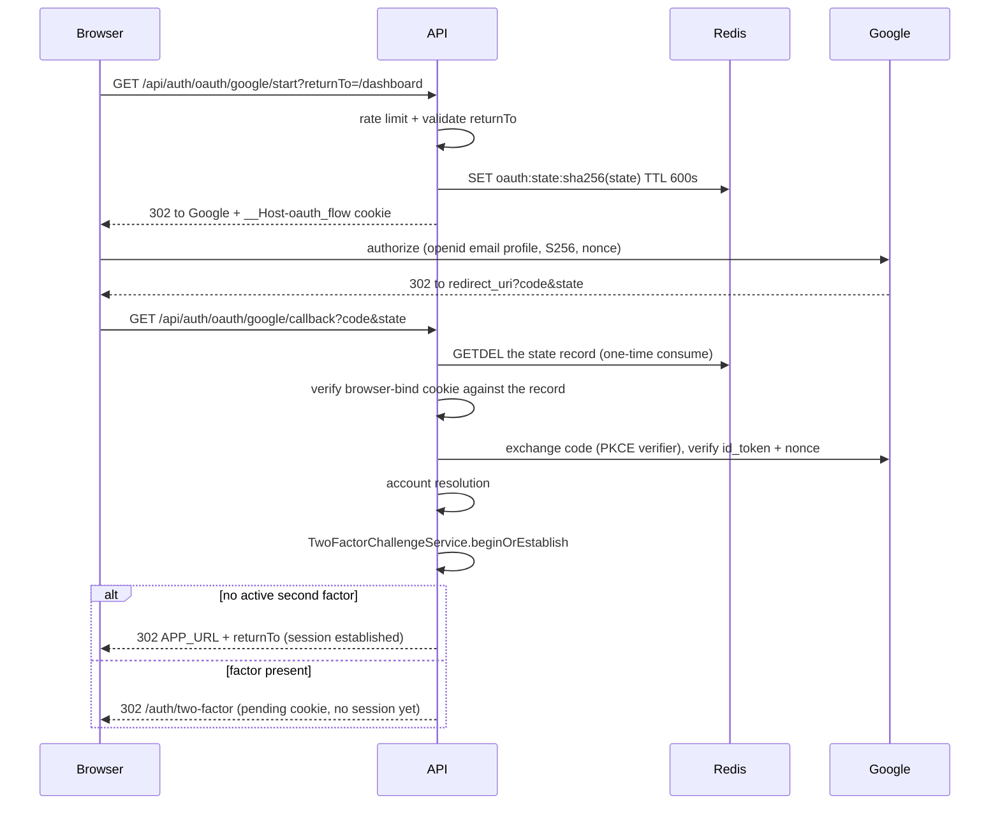

## Overview

Google sign-in adds an OIDC authorization-code flow (with PKCE) to the existing Redis-session auth ([auth-and-sessions.md](/backend/auth-and-sessions/)). It uses `openid-client` v6 directly - no passport - and the library is confined to provider classes behind a DI token, so nothing outside `providers/` ever names it. Google is the first provider; the registry is deliberately multi-provider so Microsoft/Apple/generic OIDC each slot in as one class plus one registry entry.

**v1 is web-only.** The sign-in button hides itself inside the packaged Electron shell (`IS_ELECTRON`), and the desktop loopback flow is explicitly deferred (see [Explicitly deferred](#explicitly-deferred-v2-do-not-re-litigate)).

**Prerequisite:** the feature only works against real Google once you create Google Cloud OAuth clients for your environments (see the [deployment runbook](/operations/google-oauth-deployment/)). Until credentials are configured the provider registers as disabled: the API boots normally, discovery omits Google, and its routes 404. Tests never need real credentials (they inject a fake `OPENID_CLIENT`), so missing credentials block real-world sign-ins, not development.

The registry, the Google provider, the discovery endpoint, the schema, the config surface, and the web components are documented here from landed code. Where shipped code and this page disagree, the code wins and this page should be corrected.

Backend module layout (`apps/api/src/modules/auth/oauth/`):

- `oauth.module.ts` - imports; binds `OPENID_CLIENT` to the real `openid-client` module
- `oauth.controller.ts` - `GET /api/auth/oauth/providers` | `/:provider/start` | `/:provider/callback`
- `oauth.constants.ts` - route paths, the `redirect_uri` builder, Redis key prefixes, TTLs, error codes
- `oauth-flow.service.ts` - state/nonce/PKCE issue and one-time consume (Redis)
- `oauth-account.service.ts` - the account-resolution algorithm
- `providers/oauth-provider.interface.ts` - `IOAuthProvider`, `IOAuthIdentity`, the `OAUTH_PROVIDERS` and `OPENID_CLIENT` tokens
- `providers/provider-registry.service.ts` - by-key lookup plus `getEnabled()`
- `providers/google.provider.ts` - the only importer of openid-client (via the token)

The web side lives in `apps/web/src/features/auth/` (`OAuthButtons`, `OAuthErrorAlert`, `Auth.constants.ts`).

## Data model

`packages/database/prisma/schema/identity.prisma`:

```prisma
model OAuthAccount {
  id                String  @id @default(cuid())
  provider          String
  providerAccountId String
  email             String
  emailVerified     Boolean
  userId            String
  user              User    @relation(fields: [userId], references: [id], onDelete: Cascade)
  createdAt         DateTime @default(now())
  lastUsedAt        DateTime @updatedAt

  @@unique([provider, providerAccountId])
  @@index([userId])
}
```

- **Identity is always `(provider, providerAccountId)`** - the OIDC `sub` claim. The `email` column is a snapshot refreshed on every sign-in (so an operator can see what Google currently reports) and is **never a lookup key**: a Google-side email change must not re-point the link at a different user.
- **The unique is table-wide, not per user.** One Google account can never be linked to two users, or either could sign in as the other.
- **No token columns.** v1 requests no offline access and stores no access/refresh tokens, so a database leak leaks no Google credentials.
- **Outside the tenant boundary.** Like `Token`, `OAuthAccount` is a pre-auth model and sits outside the tenant-scoped `$extends` boundary ([tenancy.md](/backend/tenancy/)); the tenant lint rules carry a mirrored exemption.
- **`User.passwordHash` became nullable** for OAuth-only signups. All four consumers were swept: login treats a null hash as generic invalid-credentials and still burns a dummy Argon2id verify so response timing cannot reveal that an email is OAuth-only; password-change points OAuth-only users at password reset via a dedicated appCode; password reset is deliberately **allowed** for OAuth-only users and doubles as "set a password"; register is unchanged.
- User deletion cascades the rows; the purge cron test asserts it.

## The provider registry

Everything outside `providers/` sees only two types. `IOAuthIdentity` is the normalized claim set (`provider`, `subject`, `email`, `emailVerified`, optional `displayName`/`avatarUrl`); `IOAuthProvider` is the contract a provider implements (`key`, `isEnabled`, `buildAuthorizationUrl`, `handleCallback`). Provider-specific weirdness (Apple's ES256 client-secret JWT, Microsoft's multi-tenant issuer validation) stays inside its own provider file.

- Providers register into the `OAUTH_PROVIDERS` DI token array. `ProviderRegistryService` indexes them by key, fails the boot on a duplicate key, and answers the two questions the surface asks: `getEnabled()` for discovery and `get(key)` for route params.
- `get()` returns nothing for a disabled provider, so an unknown key and a configured-off key are indistinguishable to a caller: the controller 404s both before any redirect is built, and a probe cannot learn which providers a deployment merely has the code for.
- `OPENID_CLIENT` is a DI token wrapping the openid-client function surface (`discovery`, `buildAuthorizationUrl`, `authorizationCodeGrant`). Provider specs inject a fake and assert the exact arguments handed to the library - no network, no Google project.

`GoogleProvider` specifics worth knowing:

- It discovers against the **issuer** `https://accounts.google.com`, not the discovery-document URL - passing the document URL would disable openid-client's issuer validation.
- Scopes are `openid email profile`, nothing more. No offline access.
- Discovery is lazy and memoized per process, and a **failed** attempt is not retained - otherwise one Google outage during boot would permanently break the button.
- ID-token claims are validated with zod rather than trusted, and `email_verified` accepts the string forms `"true"`/`"false"` explicitly: a string `"false"` coerced by truthiness would silently turn an unverified address into a trusted one.
- `handleCallback` asserts that the callback URL it is handed matches the configured `redirect_uri`, because openid-client derives the token request's `redirect_uri` from that URL - a caller that rebuilt it from the request Host would silently defeat the Host-header rule below.

### Adding a second provider

One class plus wiring; no controller, flow, or schema change:

1. A provider class in `providers/` implementing `IOAuthProvider`, reading only its own `OAUTH_<PROVIDER>_*` config keys (both-or-neither pair, same Joi pattern).
2. Register it into the `OAUTH_PROVIDERS` array in `oauth.module.ts`.
3. Web: widen `OAUTH_PROVIDER_KEYS` in `Auth.constants.ts`. `PROVIDER_CHROME` in `OAuthButtons` is a `Record` over that union, so the build fails until the new provider brings its own mark and button treatment instead of silently inheriting Google's; add the display name and i18n as the compiler directs.
4. Docs: extend the [deployment runbook](/operations/google-oauth-deployment/) with the provider's console steps.

## Runtime discovery

`GET /api/auth/oauth/providers` (public, unauthenticated, global throttle) returns:

```json
{ "providers": [{ "key": "google" }] }
```

`providers` is always present and `[]` when nothing is enabled, so the SPA renders from one shape. The key is the whole contract - label, icon, and every word of branding are owned by the web. Enablement is a **runtime** answer rather than a `VITE_` build flag because one built SPA artifact serves every environment and the Electron shell ships a prebuilt renderer that could not carry a per-environment flag.

## The flow end to end

Two endpoints, both redirect-based (this surface cannot be tRPC), both throttled, neither behind Turnstile, and OAuth failures never feed the login lockout counters.



**Start** (`GET /api/auth/oauth/:provider/start?returnTo=<path>&intent=login|link`):

1. Named per-IP throttle. `intent=link` additionally requires a valid session and a live [sudo flag](#connected-accounts-and-the-sudo-flag).
2. `returnTo` must be a relative path: starts with `/`, no `//`, no scheme; anything else falls back to `/dashboard` (`OAUTH_DEFAULT_RETURN_TO`).
3. Generates state (32 bytes), nonce, PKCE verifier/challenge, and a browser-bind value. The bind value rides in a `__Host-oauth_flow` cookie (Lax, Secure, 10 min); the rest is stored in Redis under `oauth:state:<sha256(state)>` with a 600 s TTL (`OAUTH_STATE_TTL_SECONDS`). Keying by the **hash** of state means a Redis dump cannot be replayed as a state parameter.
4. 302 to Google with an S256 code challenge. The `redirect_uri` is `${API_PUBLIC_URL}/api/auth/oauth/google/callback`, built by `buildOAuthRedirectUri()` from config and **never from the request Host header** - a Host-derived value would let a forged Host steer the authorization code to another origin. Only the origin of `API_PUBLIC_URL` is used, so a path suffix on the key is ignored rather than silently doubled up.

**Callback** (`GET /api/auth/oauth/:provider/callback?code&state`):

1. Strict throttle. The state record is consumed via `GETDEL` - single use is atomic; a missing record redirects to `/auth?error=oauth_state_expired`. The `__Host-oauth_flow` hash must match the record (the browser finishing the flow is the browser that started it), then the cookie is cleared.
2. `provider.handleCallback(...)` exchanges the code; openid-client verifies issuer, audience, expiry, signature, and nonce, and returns an `IOAuthIdentity`. Any failure in this step redirects to `/auth?error=oauth_failed` - deliberately one indistinguishable bucket.
3. `intent=login` runs [account resolution](#account-resolution-login-intent); `intent=link` runs [link completion](#connected-accounts-and-the-sudo-flag).
4. Success is a 302 to `APP_URL + returnTo` with the session established, or to the SPA challenge route when 2FA is required. Failure is always a 302 to `/auth?error=<code>` - the appCode contract, never JSON.

Nothing token-shaped is ever logged, and `sentry-scrub.ts` is extended to scrub `code`, `state`, `id_token`, and token fields.

### The 2FA seam

The callback **must not** call `AuthSharedService.establishSession` directly. After resolving a user it calls `TwoFactorChallengeService.beginOrEstablish(req, res, user, opts)` - the same post-credential chokepoint password login uses ([two-factor-authentication.md](/backend/two-factor-authentication/#the-login-challenge-seam)). A `session` outcome 302s to `returnTo`; a `challenge` outcome 302s to `/auth/two-factor` with the pending `__Host-2fa` cookie already set by the seam. So a Google-side compromise of a linked account still faces the TOTP challenge.

- `rememberMe` is always `false` for OAuth sessions: the flow has no checkbox, so it gets the default session TTL, never the extended one.
- The **session epoch** is captured before the linked identity is read and passed into `beginOrEstablish`, so a revoke-all racing the callback wins ([the fence](/backend/auth-and-sessions/#the-session-epoch-fence)).
- Both rules are lint-enforced (`establish-session-callers`, `session-epoch-captured`): an OAuth entry point written without them fails `pnpm lint:meta`, not code review.

## Account resolution (login intent)

In priority order:

1. **Known identity.** `OAuthAccount` lookup by `(provider, sub)`. Deleted/locked users mirror password-login behavior (restore-or-reject parity). The row's `email` snapshot and `lastUsedAt` are refreshed - this never touches `User.email`. Audits `oauth.login`; proceeds to the seam.
2. **Email conflict.** No linked identity, but a `User` exists with the identity's email. Auto-link happens only when **all** of these hold: Google reports the email verified, the local account's email is verified, the user has **zero active second factors**, the account has **no password**, and it is neither deleted nor locked (nor removed from its organization). The password rule closes account pre-hijacking: a password chosen at registration predates any proof of inbox control, so somebody who registered the victim's address must not have that password ride along into the victim's Google sign-in. In practice every password account links Google from settings. Auto-link creates the `OAuthAccount` row, revokes every earlier session (handing the seam the pre-check epoch plus that one bump, so a concurrent revocation still fences the mint), queues a tripwire email ("a Google account was just linked to your account - if this wasn't you, reset your password..."), audits `oauth.link`, and proceeds. If the block was the active-factors rule or the password rule the user gets `oauth_link_blocked`; every other refusal gets `oauth_account_exists`. Separately, verifying an email address by link revokes every session of the account, so a session opened at registration does not outlive the owner's verification.
3. **Signup.** No account matches. If `OAUTH_ALLOW_SIGNUP` is off: `oauth_signup_disabled`. If Google reports the email unverified: `oauth_failed` (an unverified claim is never trusted for signup or linking). Otherwise `ProvisioningService` runs the same one-transaction Organization provisioning as self-registration - Tenant plus ADMIN user (with `passwordHash: null`, `emailVerified: true`, display name and avatar from the claims, and **no** verification token; Google already verified the mailbox) plus the `OAuthAccount` row. Audits `oauth.signup` and the tenant-provisioning events with an explicit `tenantId` (pre-ALS), then proceeds - a brand-new user has no factors, so this always ends in a session.

Every failure path emits an `oauth.failure` audit row with provider and reason, never tokens.

The three infrastructure-shaped failures (authorization-url building, code
exchange, session mint) additionally emit **one structured `warn` line and one
Sentry `captureMessage`** carrying `op`, `provider`, the error's constructor
name and a string `code` when it has one, and nothing else. The error object
itself is still never logged or captured: openid-client embeds the request it
was making, the authorization URL with the `state` or the token request with the
`code`, in its messages, which is why these catches were bare to begin with.
Without the line an outage (Google down, rotated client secret, Redis
unreachable) and the epoch fence doing its job are indistinguishable, and the
only signal is users complaining. `captureMessage` rather than
`captureException` for the same reason: an exception would ship the message and
the stack.

### What each `?error=` code means

Failures land on `/auth?error=<code>` and render through `OAuthErrorAlert`. For anyone fielding a support request:

| Code                    | What actually happened                                                                                                                                                           | What to tell the user                                                                                                      |
| ----------------------- | -------------------------------------------------------------------------------------------------------------------------------------------------------------------------------- | -------------------------------------------------------------------------------------------------------------------------- |
| `oauth_failed`          | The deliberately generic bucket: bad/expired code, signature or nonce failure, Google outage, or Google reported the email unverified                                            | Try again; if it persists, check the `oauth.failure` audit rows for the reason                                             |
| `oauth_state_expired`   | The pending-flow record was gone at callback time: more than 10 minutes on the consent screen, a replayed callback URL, or a different browser/machine than the one that started | Start the sign-in again, in one browser, within 10 minutes                                                                 |
| `oauth_account_exists`  | The email belongs to an existing account this flow may not auto-link to (or, on a link attempt, the Google identity is already linked to a **different** user)                   | Sign in with the password, then link Google from Settings > Connected Accounts                                             |
| `oauth_link_blocked`    | Auto-link refused because the account has active 2FA factors (a Google-side compromise must not bypass a second factor) or has a password (account pre-hijacking)                | Sign in with the password (reset it if forgotten), then link manually from settings (which requires the sudo confirmation) |
| `oauth_signup_disabled` | No matching account and this deployment has `OAUTH_ALLOW_SIGNUP=false`                                                                                                           | An existing account is required; ask an admin (or enable signup on the deployment)                                         |

The codes are deliberately **not** members of `AppErrorCode`: they never travel in a tRPC error payload, they are URL query values on a redirect, and each side keeps its own exhaustive map (`OAUTH_ERROR_CODES` in `oauth.constants.ts` on the API; a `Record<OAuthErrorCode, string>` copy map in `OAuthErrorAlert.hooks.ts` on the web, so adding a code without shipping a sentence for it is a compile error).

## Connected Accounts and the sudo flag

The settings surface for viewing, adding, and removing linked identities:

- **Sudo flag.** The tRPC mutation `auth.confirmPassword` (authenticated) verifies the password and sets `sudo:<sessionId>` in Redis with a 300 s TTL. Link and unlink both require it, so a hijacked session alone cannot re-wire account identities. OAuth-only users (null `passwordHash`) use password reset to set a password first; the UI says so. When 2FA's step-up lands it extends the same flag; the contract does not change.
- **Link.** The settings button navigates (full page) to `/api/auth/oauth/google/start?intent=link`, which requires session + sudo. Link completion at the callback verifies the session user matches the `userId` captured in the state record, verifies the `(provider, sub)` identity is not already linked to a different user (else `oauth_account_exists`), creates the row, sends the tripwire email, audits `oauth.link`, and 302s back to settings with a success param.
- **Unlink.** A tRPC mutation, sudo required. The invariant is enforced in a transaction: refuse unless `passwordHash != null` **or** another `OAuthAccount` remains - a user must never end up with zero ways to sign in. Audits `oauth.unlink`.
- **List.** A tRPC query returning provider keys plus `createdAt`/`lastUsedAt` for the session user.

## Web UI

- **`OAuthButtons`** (`features/auth/components/OAuthButtons/`) renders from the discovery query (TanStack Query, `staleTime: Infinity` - enablement is deployment config, not session state; both auth forms share one cache entry). It renders **nothing** when the list is empty or inside Electron (the query is not even issued there), so an unconfigured environment shows no divider and no dead button. A failed discovery resolves to "no providers" rather than an error: the whole surface is optional chrome and password login is unaffected. Clicking performs a full-page `window.location.assign` to the start URL with a client-side-validated `returnTo` (the API re-validates it).
- The button is drawn to **Google's branding spec**, with literal Google hexes rather than design tokens (a third-party brand mark must not move when a token moves), the standard four-color "G" in a fixed 18 px box, and Google's light/dark color rows verbatim. Two sanctioned deviations (app font at the specified metrics, SaaS Starter CTA height/radius for equal visual weight) are asserted in `OAuthButtons.test.tsx`.
- **`OAuthErrorAlert`** reads the `error` search param (validated on the `/auth` layout route) and maps it through the copy map above; unknown values render nothing.
- Post-callback landing needs no new code: the session cookie is present and the CSRF bootstrap runs on load, exactly as after a password login.

## Configuration

Four keys, validated by Joi in `apps/api/src/config/configuration.config.ts`; the full deployment procedure (per-environment Google clients, env vars, troubleshooting) is the [Google OAuth deployment](/operations/google-oauth-deployment/) runbook.

| Key                                                     | Behavior                                                                                                                                        |
| ------------------------------------------------------- | ----------------------------------------------------------------------------------------------------------------------------------------------- |
| `API_PUBLIC_URL`                                        | The API's own public origin, sole source of the `redirect_uri`. Required in production; defaults to `http://localhost:3000` in development/test |
| `OAUTH_GOOGLE_CLIENT_ID` / `OAUTH_GOOGLE_CLIENT_SECRET` | Both-or-neither. Both empty: provider disabled, app boots fine. Half a pair: deliberate boot failure                                            |
| `OAUTH_ALLOW_SIGNUP`                                    | Default `true`. When `false`, unmatched identities get `oauth_signup_disabled`; existing linked accounts still sign in                          |

## Testing

Unit lane: the flow service, the account service (every resolution branch including the zero-factors gate), controller specs, and `google.provider.spec.ts` via an injected fake `OPENID_CLIENT` - no network, no Google project. Integration: a tenant-isolation case proving an OAuth signup is invisible cross-tenant. Web: button, error map, and renderHook specs. E2e deliberately **skips** Google in v1 (no fake-IdP fixture yet; see below). Guards: `establish-session-callers`, `session-epoch-captured`, `routes-require-test-sibling`, and sentry-scrub assertions for `code`/`state`/`id_token`.

## Explicitly deferred (v2, do not re-litigate)

These are decided-and-deferred, not gaps: re-opening one is a design decision of its own, not something to sneak into a PR:

- **Desktop loopback flow** - the packaged Electron shell hides the button entirely in v1; a loopback-redirect flow (RFC 8252) is the intended follow-up.
- **Microsoft / Apple / generic-OIDC providers** - the registry is built for them ([above](#adding-a-second-provider)), but only Google ships.
- **Refresh tokens / offline scopes** - v1 stores no tokens at all; adding them means adding columns, encryption, and a revocation story.
- **Fake-IdP e2e fixture** - would let e2e exercise the full redirect dance; until then e2e skips Google.
- **Admin visibility of members' linked providers** - the Connected Accounts surface is self-serve only.
- **Invites joining an existing Organization** - an OAuth signup always provisions a fresh Organization today, exactly like password self-signup.

## Modifying this area

- **Adding a provider:** follow [the four steps](#adding-a-second-provider); never import `openid-client` outside `providers/`.
- **Changing a TTL, path, or error code:** `oauth.constants.ts` is the single source; the web mirrors the error codes in `Auth.constants.ts` and the copy map, and both sides are exhaustively typed, so the compiler walks you to every site.
- **New OAuth audit actions:** extend the `oauth.*` namespace in `packages/shared/src/audit/index.ts` first ([audit-logging.md](/backend/audit-logging/)).
- **Anything touching session minting:** go through `TwoFactorChallengeService.beginOrEstablish` and capture the epoch first; the lint rules will hold the line either way.
