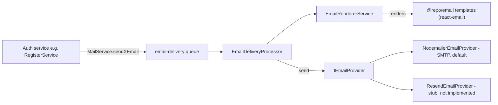

## Architecture

All outbound mail is queue-backed. `MailService` (`apps/api/src/modules/mail/mail.service.ts`) is an **enqueue-only** producer facade; nothing renders or sends mail on the request path. Rendering and transport happen entirely inside a BullMQ worker.



Modules involved:

- `apps/api/src/modules/mail/mail.module.ts` - producer side, exports `MailService`.
- `apps/api/src/modules/mail/email-transport.module.ts` - provides `EmailRendererService` and both provider implementations; picks one via env at DI-factory time.
- `apps/api/src/modules/mail/email-delivery/` - the BullMQ queue registration and processor (consumer side).
- `packages/email/src/templates/` - the actual React-email templates, in a separate ESM-only package.

## Why mail is enqueue-only

The class doc comment on `MailService` explains the history directly: critical auth mail (verification, password reset) used to be sent inline so a failure surfaced synchronously to the caller. That inline SMTP round-trip sat on the p95 of register/forgot-password/resend-verification, and - more importantly - gave the _unknown-email_ branch of forgot-password a roughly 1-second timing signal relative to the _known-email_ branch, which is an account-enumeration side channel. Mail is now enqueue-only everywhere; callers await only the enqueue itself, not delivery.

## Two priority classes

- **Critical** transactional auth mail (verification, password reset) enqueues with **no** `priority` option. BullMQ drains its plain `wait` list before any prioritized jobs, so unprioritized is the effective highest-priority class.
- **Non-critical** mail (welcome, password-changed) enqueues with `priority: EMAIL_DELIVERY_NON_CRITICAL_PRIORITY` (= 10), so a burst of it can never delay critical auth mail.

`MailService` methods and their dedup strategy:

| Method                                | Class        | `jobId` (dedup key)                                                                                                                                                           |
| ------------------------------------- | ------------ | ----------------------------------------------------------------------------------------------------------------------------------------------------------------------------- |
| `sendVerificationEmail(to, url)`      | Critical     | `verification-${sha256(url)}` - one id per single-use token; a resend mints a new token and gets a fresh id                                                                   |
| `sendPasswordResetEmail(to, url, ip)` | Critical     | `password-reset-${sha256(url)}` - same pattern                                                                                                                                |
| `sendWelcomeEmail(to, url, userId)`   | Non-critical | `welcome-${userId}` - a user is welcomed once                                                                                                                                 |
| `sendPasswordChangedEmail(to)`        | Non-critical | `password-changed-${sha256(requestId)}` (or none outside a request context) - each password change is distinct, but a producer retry within one request collapses to one mail |

Deterministic `jobId`s mean a producer-side retry (a double-submit, a tRPC replay) cannot double-enqueue the _same_ mail, while a genuinely new event (a fresh token, a second password change) still gets its own job.

On a **critical** mail's enqueue failure, `mailSendFailuresTotal` is incremented immediately and the error is rethrown to the caller. Non-critical enqueue failures are not caught inside `MailService`; the calling service wraps them in its own try/catch (see the `emailSent` section below for how registration handles this).

## The email-delivery queue

`apps/api/src/modules/mail/email-delivery/email-delivery.constants.ts`:

| Setting            | Value                                                                                                                                       |
| ------------------ | ------------------------------------------------------------------------------------------------------------------------------------------- |
| Queue name         | `email-delivery`                                                                                                                            |
| Job names          | `send-verification`, `send-password-reset`, `send-welcome`, `send-password-changed`                                                         |
| Attempts           | 5                                                                                                                                           |
| Backoff            | exponential, 5s base delay                                                                                                                  |
| `removeOnComplete` | age 3600s, count 100                                                                                                                        |
| `removeOnFail`     | age 604800s (7-day bounded DLQ - capped deliberately because a failed payload carries the recipient's email address, a PII-at-rest concern) |
| Concurrency        | 5                                                                                                                                           |

`EmailDeliveryProcessor` (`apps/api/src/modules/mail/email-delivery/email-delivery.processor.ts`), `@Processor('email-delivery', { concurrency: 5 })`, extends `TracedWorkerHost` (see [background-jobs.md](/backend/background-jobs/)). For each job it re-validates `job.data` against a zod schema (job payloads round-trip through Redis as JSON, so a compile-time type proves nothing about actual runtime content), renders the matching template via `EmailRendererService`, and calls `provider.send({to, subject, html})`. Subjects are hardcoded per template ("Verify your email address", "Reset your password", `Welcome to ${appName}!`, "Your password has been changed"). An unknown job name throws `UnrecoverableError` - straight to the failed set, no retries.

## Provider seam

`apps/api/src/modules/mail/providers/email-provider.interface.ts`:

```ts
export interface IEmailMessage {
  readonly to: string;
  readonly subject: string;
  readonly html: string;
  readonly from?: string;
}
export interface IEmailProvider {
  send(message: IEmailMessage): Promise<void>;
}
```

Selection is env-based (`EMAIL_PROVIDER=smtp|resend`, default `smtp`), resolved once at DI-factory time in `email-transport.module.ts`. Both provider classes are always instantiated (their constructors must stay inert regardless of which one is active) and the factory picks one to bind to the `EMAIL_PROVIDER` DI token.

- **`NodemailerEmailProvider`** (default) - real SMTP transport. Points at Mailpit locally in dev, a real SMTP relay in production. Reads `SMTP_HOST`/`SMTP_PORT` (required), optional `SMTP_USER`/`SMTP_PASS` (an unauthenticated transport is valid for Mailpit), and `SMTP_FROM` (required). Never logs the recipient address, only the subject, on the redacted structured log channel.
- **`ResendEmailProvider`** - **a stub, not implemented.** Its constructor reads `RESEND_API_KEY` but does not require it (so booting with `EMAIL_PROVIDER=smtp` never fails due to a missing Resend key). Calling `send()` always throws `NotImplementedException('Resend email transport is a stub. Set EMAIL_PROVIDER=smtp or implement ResendEmailProvider.send.')`. If you need to actually ship on Resend, this is a real gap: the wiring comment in the file gives the exact steps (`pnpm --filter @repo/api add resend`, then construct `new Resend(apiKey)` and call `resend.emails.send(...)`), but nobody has implemented it yet.

**What happens on provider failure**: whatever `send()` throws propagates up through the processor's `deliver()`, gets rethrown, and BullMQ retries per the queue's `defaultJobOptions` above. There is no provider-level retry logic; retry is entirely BullMQ's job-level mechanism. There is also no custom dead-letter queue construct - BullMQ's native "failed" job set _is_ the DLQ, bounded by the 7-day `removeOnFail` age. There is no re-drive mechanism in code today; a failed job either ages out or needs manual operator intervention.

## Templates

`packages/email/src/templates/` - exactly four templates exist, each wrapped in a shared `EmailLayout` (`packages/email/src/components/layout.tsx`):

| Template               | Props                                          | Triggered by                                                                                                           |
| ---------------------- | ---------------------------------------------- | ---------------------------------------------------------------------------------------------------------------------- |
| `verification.tsx`     | `{ verificationUrl, appName, expiresIn? }`     | `register.service.ts` (registration) and `email-verification.service.ts` (resend-verification)                         |
| `password-reset.tsx`   | `{ resetUrl, appName, ipAddress, expiresIn? }` | `password-reset.service.ts` (forgot-password request)                                                                  |
| `welcome.tsx`          | `{ appName, loginUrl }`                        | `email-verification.service.ts`, immediately after a user verifies their email                                         |
| `password-changed.tsx` | `{ appName }`                                  | `password-change.service.ts` (logged-in change) and `password-reset.service.ts` (after a successful token-based reset) |

There is **no "account deletion" confirmation template**, despite account deletion being a fully-built feature - see [users-and-account-lifecycle.md](/backend/users-and-account-lifecycle/#no-deletion-confirmation-email). If your task involves deletion notifications, you're building this from scratch, not wiring an existing template.

The `expiresIn` prose is generated from the actual shared TTL constants (`VERIFICATION_TOKEN_TTL_MS`, `PASSWORD_RESET_TOKEN_TTL_MS` via `formatTokenTtl()`), so the email copy can never drift from the real token lifetime - if you change a TTL constant, the email text updates automatically.

`EmailRendererService` (`apps/api/src/modules/mail/email-renderer.service.ts`) is the single point that dynamically imports the ESM-only `@repo/email` package into the CJS-compiled `apps/api` (via an `esmImport` workaround), caching the module promise so it's only evaluated once per process. All rendering happens inside the worker, never on the request path.

## The `emailSent` contract

This field exists in exactly one place: the registration flow. `apps/api/src/modules/auth/services/register.service.ts`:

```ts
export interface IRegisterResult {
  // ...
  /**
   * Whether the verification email was successfully ENQUEUED (delivery itself
   * is async, retried, and DLQ-backed). False when the enqueue threw, so the
   * client can surface a "we could not send the email, use resend" hint
   * instead of leaving the user waiting for mail that never comes.
   */
  emailSent: boolean;
}
```

`finalizeRegistration()` awaits only the enqueue call; if it throws, `emailSent` is set to `false`, the error is logged, and **registration itself does not fail**. The client is expected to check `emailSent` and prompt the user toward the resend-verification flow if it's `false`.

This is deliberately the _only_ router procedure that surfaces a per-call mail success/failure signal. Both other mail-triggering flows go out of their way to **not** do this, for anti-enumeration reasons:

- `forgotPassword()` always returns success regardless of whether the account exists or the enqueue succeeded. Quoted from the code: "Never throw here: the response must be indistinguishable from the unknown-email branch (anti-enumeration), and the failure is observable via mail_send_failures_total." An enqueue failure is only logged, never surfaced to the caller.
- `resendVerification()` follows the identical pattern - failures are logged, never thrown, "mirroring forgot-password's tolerance."

If you're adding a new mail-triggering flow and wondering whether to add an `emailSent`-style field to its output: the answer depends on whether the flow can leak account existence. Registration can't (the caller already knows the account exists, they just created it); forgot-password and resend-verification can, which is why they deliberately stay silent.

## Failure observability

- **Metric**: `mailSendFailuresTotal` (`mail_send_failures_total`, labeled by `template` = the BullMQ job name). Incremented at the **producer** on a critical mail's enqueue failure, and at the **worker** only on the _final_ failed attempt (via `isFinalJobAttempt`, shared with `TracedWorkerHost`'s Sentry gate) - so retries in progress are never double-counted.
- **Sentry**: `TracedWorkerHost.process()` captures the exception on the final attempt only, with `queue`, `jobName`, `jobId`, `attempt`, `maxAttempts`, `requestId` as extra context.
- **Prometheus alerts** (`observability/prometheus/rules/api.rules.yml`):

  ```yaml
  - alert: MailSendFailures
    expr: increase(mail_send_failures_total[15m]) > 0
    labels: { severity: critical }
    annotations:
      summary: 'Emails are being lost'

  - alert: EmailQueueDLQNonEmpty
    expr: max_over_time(queue_jobs_failed[10m]) > 0
    labels: { severity: warning }
    annotations:
      summary: 'Queue has failed (DLQ) jobs'
  ```

  `EmailQueueDLQNonEmpty` also fires for a stuck `notification-dispatch` job, since `queue_jobs_failed` is a shared gauge labeled by queue name across both queues (see [background-jobs.md](/backend/background-jobs/)).

## Modifying this area

- **Adding a new transactional email**: add a template under `packages/email/src/templates/`, add its props type + a job name constant in `email-delivery.constants.ts` and payload type in `email-delivery.types.ts`, add a zod schema in `email-delivery.schemas.ts`, wire a render method into `EmailRendererService`, add a case to `EmailDeliveryProcessor.deliver()`, and add a `sendXEmail()` method to `MailService` following the existing critical/non-critical priority convention.
- **Switching providers**: set `EMAIL_PROVIDER=resend` - but note `ResendEmailProvider.send()` will throw until someone implements it (see above). Don't flip this in production without doing that work first.
- **Local dev SMTP**: point `SMTP_HOST`/`SMTP_PORT` at Mailpit (or similar), leave `SMTP_USER`/`SMTP_PASS` empty for an unauthenticated transport.
- Running the mail test suite: `pnpm --filter @repo/api test -- mail`.
