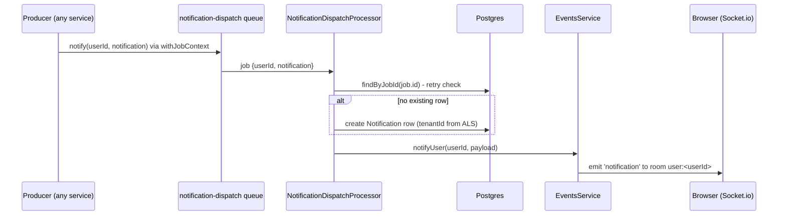

## Model of truth: the database, not the socket

`packages/database/prisma/schema/notifications.prisma`:

```prisma
model Notification {
  id        String    @id @default(cuid())
  userId    String
  tenantId  String?
  type      String
  title     String
  message   String
  jobId     String?   @unique
  readAt    DateTime?
  createdAt DateTime  @default(now())

  user User @relation(fields: [userId], references: [id], onDelete: Cascade)

  @@index([userId, readAt])                // unread-count lookup
  @@index([userId, createdAt(sort: Desc)])  // bell hydrate, newest-first
  @@index([createdAt])                      // retention sweep by createdAt < cutoff
}
```

The schema's own comment states the design directly: "Socket.io NOTIFICATION events are delivery only, never storage - the notification-dispatch worker writes the row FIRST and emits after, so a page refresh rehydrates exactly what was delivered."

Key details:

- `type` is a plain TEXT column on purpose; the `'info' | 'success' | 'warning' | 'error'` union is enforced only at the app boundaries (the dispatch job schema on the way in, the tRPC output schema on the way out), not by a DB enum or check constraint.
- `readAt: null` means unread. There is no separate boolean flag.
- `jobId` (unique, nullable) is the BullMQ job id, used purely for retry-idempotency at the worker - it is stripped from every client-facing projection.
- `tenantId` is present on the row (mirroring `AuditLog`'s "scope column, no FK" pattern) but is **not** used to scope reads or writes today - every notification query is explicitly scoped by `userId` instead, since a user's own notification feed is inherently user-scoped regardless of tenant. It's populated from the request context when available and left `null` for system-generated notifications.
- `onDelete: Cascade` on the user relation - deleting a `User` row cascades its notification feed away (the [user-purge cron](/backend/background-jobs/) relies on this).

## Producing a notification

`NotificationsService.notify(userId, notification)` (`apps/api/src/modules/notifications/notifications.service.ts`) is the **sole** producer path. It does nothing but enqueue:

```ts
await this.queue.add(
  NOTIFICATION_DISPATCH_JOB_NAMES.DISPATCH,
  withJobContext({ userId, notification }),
);
```

No custom `jobId` is set by the producer - every `notify()` call is meant to be a distinct notification. Idempotency under BullMQ retry is instead enforced downstream, by the `Notification.jobId` unique column (see below).

## Delivery: persist first, emit second



`NotificationDispatchProcessor` (`apps/api/src/modules/notifications/notification-dispatch/notification-dispatch.processor.ts`), `@Processor('notification-dispatch', { concurrency: 5 })`, extends `TracedWorkerHost` (see [background-jobs.md](/backend/background-jobs/) for why that base class is mandatory):

1. Looks up an existing row by `job.id` via `findByJobId` - this is the retry-idempotency check. If a retried attempt finds a row already created by attempt 1, it skips the insert and only re-emits.
2. If none exists, creates the row with `tenantId: getRequestContext()?.tenantId ?? null`.
3. Emits the Socket.io event via `EventsService.notifyUser(userId, payload)` - **after** the row is committed, never before.
4. Unknown job names throw `UnrecoverableError` (straight to the failed set, no retry - a job name typo can never succeed by retrying).

Queue configuration (`notification-dispatch.constants.ts`):

| Setting            | Value                                                                                                          |
| ------------------ | -------------------------------------------------------------------------------------------------------------- |
| Queue name         | `notification-dispatch`                                                                                        |
| Job name           | `dispatch` (single job type)                                                                                   |
| Attempts           | 3                                                                                                              |
| Backoff            | exponential, 5s base delay                                                                                     |
| `removeOnComplete` | age 3600s, count 100                                                                                           |
| `removeOnFail`     | age 604800s (7-day bounded DLQ - the payload can carry user-identifying content, so it isn't retained forever) |
| Concurrency        | 5                                                                                                              |

There is **no email or push side effect** triggered from notification dispatch. Delivery is exclusively: enqueue → Postgres row (source of truth) → best-effort Socket.io emit. If you need a notification to also send an email, that's a separate call to `MailService` (see [mail.md](/backend/mail/)) from the same producer, not something the notification pipeline does for you.

### Module split, and why

Registration is deliberately split across two files to avoid a dependency cycle: `NotificationsModule` (the producer + reader side, imports only queue registration) does **not** import `EventsModule`, because `EventsModule` itself imports `NotificationsModule` (for the gateway's dev-only test-notification trigger). The consumer/processor side lives in its own `notification-dispatch` submodule, imported only by `AppModule` and `QueueObservabilityModule`.

## Reading the feed: `notifications.router.ts`

Class-gated by `AuthMiddleware`. Three procedures, alias `notifications`:

| Procedure                   | Type     | Input                                             | Output                                               |
| --------------------------- | -------- | ------------------------------------------------- | ---------------------------------------------------- |
| `notifications.list`        | Query    | `{ limit?: 1-100, default 50 }` (prefaulted `{}`) | `{ items: NotificationItem[], unreadCount: number }` |
| `notifications.markRead`    | Mutation | `{ id: string }`                                  | `{ updated: boolean }`                               |
| `notifications.markAllRead` | Mutation | -                                                 | `{ updated: number }`                                |

`markRead`/`markAllRead` deliberately skip `IdempotencyMiddleware` - they're implemented as `updateMany({ where: { id, userId, readAt: null } })`, which is naturally idempotent (a repeat call matches zero rows and no-ops rather than erroring). The `userId` in every `where` clause (never trusted from input) is what closes the IDOR hole: a caller can only mark their own notifications read, never another user's by guessing an id.

Shared zod contracts, `packages/shared/src/schemas/notifications.ts`:

```ts
export const notificationTypeSchema = z.enum(['info', 'success', 'warning', 'error']);
export const NOTIFICATION_LIST_DEFAULT_LIMIT = 50;
export const NOTIFICATION_LIST_MAX_LIMIT = 100; // hard cap so a client can't request the whole table
```

`notificationTypeSchema` is kept in lockstep with the socket wire payload's `type` field via a `satisfies z.ZodType<NotificationPayload['type']>` check, so the two contracts can't silently drift apart.

## Bell semantics

There is no dedicated `unreadCount` endpoint - it rides along in `notifications.list`'s output, computed across the **whole table** for that user (not just the returned page), so the badge reflects the true unread total even when the list itself is paginated.

The frontend does not poll. `apps/web/src/features/notifications/components/NotificationBell/NotificationBell.hooks.ts` hydrates once via `notifications.list` (a TanStack Query cache entry) and merges live Socket.io `notification` events into that same cache entry as they arrive. `markAllRead` does an optimistic update (zeroing `unreadCount` locally) before reconciling with the server response.

## Real-time push (`events.gateway.ts` / `events.service.ts`)

`EventsService.notifyUser(userId, payload)` emits `SocketEvents.NOTIFICATION` to the Socket.io room `user:<userId>`. Its own doc comment: "Delivery only, never storage: the notification-dispatch worker persists the Notification row FIRST and calls this after, so the socket event is a live signal on top of the DB-backed bell, not the source of truth."

`EventsGateway` authenticates sockets via the session cookie at connection time and joins each socket to its `user:<userId>` room. The gateway's only direct reference to `NotificationsService` is a development-only `test:notification` handler (`handleTestNotification`), which returns `{ok: false}` in production and otherwise calls `sendTestNotification(user)` - this rides the exact same production pipeline (enqueue → persist → emit), it's a smoke-test trigger, not a separate code path.

`EventsService.disconnectUser(userId)` force-disconnects a user's live sockets; it's called alongside session revocation (logout-all, role change, account deletion) so a live tab can't keep receiving events for an identity that no longer has a valid session.

## Retention

`apps/api/src/modules/notifications/notification-retention.service.ts`:

```ts
@Cron(CronExpression.EVERY_DAY_AT_5AM, { name: 'notification-retention' })
```

Scheduled one hour after the audit-log retention sweep (4 AM) deliberately, so the two daily batched deletes never contend for the same maintenance window.

- Retention window: `NOTIFICATION_RETENTION_DAYS` env var, default **90 days**.
- **Deletes rows older than the cutoff regardless of read state.** Quoted directly from the code: "the bell is a recent-items surface, not an archive, and 90 days (the default) is already generous for 'you have a notification'." If you need permanent notification history, this cron will delete it - the retention window is not configurable per-notification-type today.
- Batched: 5000 rows per pass (select-then-delete-by-id, since `deleteMany` can't `LIMIT`), capped at 200 batches per tick (roughly a 1M-row/day ceiling; a larger backlog drains across consecutive days rather than holding one long-running sweep open).
- Idempotency contract, quoted directly: "Idempotent by predicate (createdAt < cutoff), so it races safely when @Cron fires on every replica. Best-effort: sweep() NEVER throws; a failed tick logs and returns 0."
- Emits `notification_retention_deleted_total` (Prometheus counter) so the sweep's work is observable.
- Uses the unscoped Prisma client directly, since `Notification` is not a tenant-scoped model (see [tenancy.md](/backend/tenancy/)).

## Modifying this area

- **Adding a new notification type**: extend `notificationTypeSchema` in `packages/shared/src/schemas/notifications.ts` and the matching union in `packages/shared/src/events/index.ts` (`NotificationPayload['type']`) together - the `satisfies` check will fail to compile if they drift.
- **Triggering a notification from a new feature**: call `NotificationsService.notify(userId, { type, title, message })`. Do not write directly to the `Notification` table - the queue/persist-then-emit ordering is what keeps a page refresh consistent with what was actually delivered.
- **Changing retention**: set `NOTIFICATION_RETENTION_DAYS` (env var, `Joi.number().integer().min(7)`, default 90).
- Running the notifications test suite: `pnpm --filter @repo/api test -- notification`.
