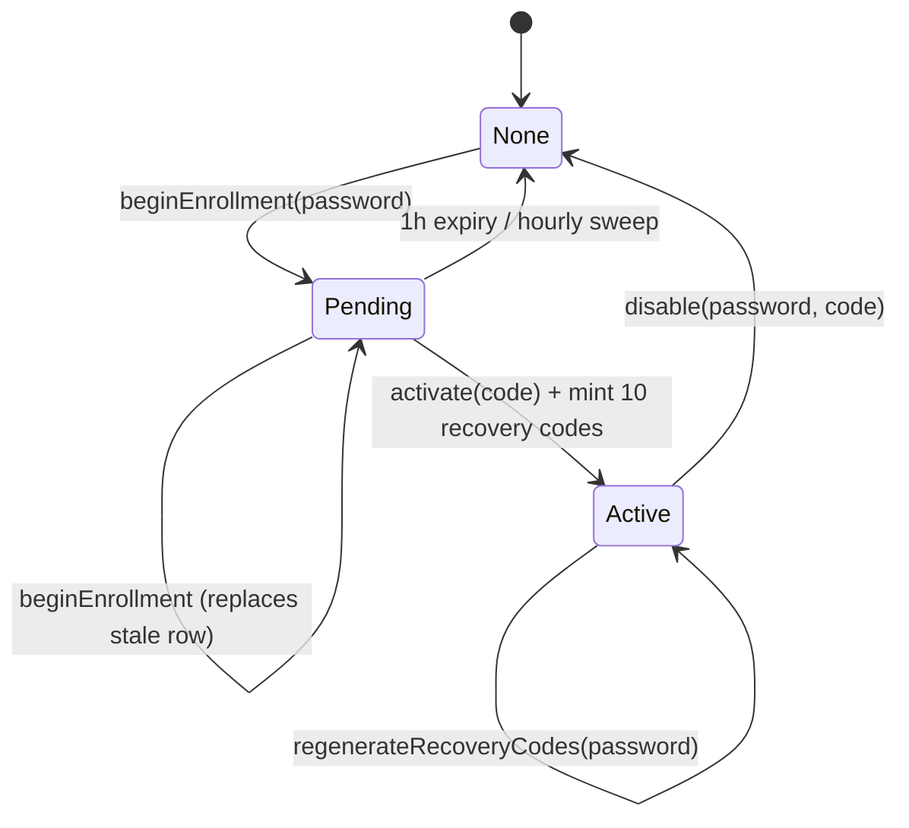
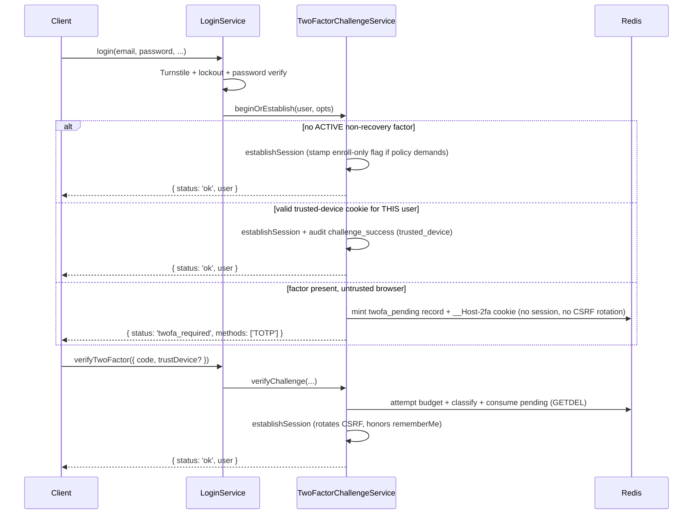

## Overview

2FA layers a TOTP (authenticator-app) second factor on top of the existing Redis-session auth ([auth-and-sessions.md](/backend/auth-and-sessions/)), plus recovery codes, "remember this browser" trusted devices, and a per-Organization enforcement policy. The factor model is deliberately factor-agnostic so WebAuthn can be added later with no rework (a `WEBAUTHN` enum value is already reserved with no v1 code path).

Core files, all under `apps/api/src/modules/auth/`:

- `two-factor.router.ts` - the protected `twoFactor` tRPC surface (status, enroll, disable, regenerate, revoke trusted devices, tenant policy, admin reset)
- `services/two-factor.service.ts` - enrollment lifecycle (begin / activate / disable / regenerate) and the settings `status` read
- `services/two-factor-challenge.service.ts` - `TwoFactorChallengeService`, the single post-credential chokepoint (`beginOrEstablish`) and the challenge verify (`verifyChallenge`)
- `services/totp.service.ts` - the sole home of the `otpauth` library; secret generation, encryption, verify + replay guard
- `services/trusted-device.service.ts` - opaque Redis-backed "remember this browser" tokens
- `services/two-factor-policy.service.ts` - per-Organization policy, the tenant-admin member reset, and the login-context enforcement check
- `services/two-factor-cleanup.service.ts` - hourly sweep of abandoned PENDING enrollments
- `two-factor-enforcement/` - the daily BullMQ job-scheduler sweep that forces non-enrolled members out after grace and sends T-24h reminders
- `repositories/second-factor.repository.ts` - all `SecondFactor` reads/writes
- `two-factor.util.ts` - recovery-code generation/normalization and the TOTP/recovery shape classifiers
- `auth.constants.ts` - every locked constant and the two cookie-name resolvers

Contracts live in `packages/shared/src/schemas/auth.ts` (zod input/output), `packages/shared/src/audit/index.ts` (audit actions), and `packages/shared/src/errors` (the new `AppErrorCode`s). Email templates live in `packages/email`.

## Data model

`packages/database/prisma/schema/identity.prisma`, created by the baseline migration (`0_init`), whose hand-appended partial-index block carries the partial-unique index that allows one active TOTP factor per user.

```prisma
enum SecondFactorType { TOTP RECOVERY_CODE WEBAUTHN } // WEBAUTHN reserved, no v1 path
enum SecondFactorStatus { PENDING ACTIVE }

model SecondFactor {
  id            String             @id @default(cuid())
  userId        String
  type          SecondFactorType
  status        SecondFactorStatus @default(PENDING)
  totpSecretEnc String?            // AES-256-GCM encrypted base32 secret (TOTP rows)
  codeHash      String?            // sha256 of a recovery code (RECOVERY_CODE rows)
  usedAt        DateTime?          // recovery-code redemption timestamp
  friendlyName  String?
  activatedAt   DateTime?
  lastUsedAt    DateTime?
  createdAt     DateTime           @default(now())
  updatedAt     DateTime           @updatedAt
  user User @relation(fields: [userId], references: [id], onDelete: Cascade)
  @@index([userId, type, status])
  @@unique([userId, codeHash])
}

model TwoFactorPolicy {
  id          String    @id @default(cuid())
  tenantId    String    @unique
  required    Boolean   @default(false)
  graceEndsAt DateTime?
  createdAt   DateTime  @default(now())
  updatedAt   DateTime  @updatedAt
  tenant Tenant @relation(fields: [tenantId], references: [id], onDelete: Cascade)
}
```

Key design points:

- **One row per recovery code.** A user with recovery codes has one `RECOVERY_CODE` row per code. Redemption is a point lookup by `(userId, codeHash)` and an atomic update on `usedAt: null`.
- **"Enabled" is derived, not stored.** There is no column on `User`. A user is "2FA enabled" iff they have an `ACTIVE` factor whose type is not `RECOVERY_CODE` (recovery codes alone never count). Every consumer uses this same predicate (`SecondFactorRepository.findActiveNonRecovery`).
- **Hard delete on disable/reset.** There is no `REVOKED` status; disable and reset delete the rows outright. The history lives in `AuditLog` ([audit-logging.md](/backend/audit-logging/)).
- **One ACTIVE TOTP per user, enforced in SQL.** `@@unique([userId, codeHash])` cannot enforce this (TOTP rows have `codeHash = NULL`, and Postgres treats NULLs as distinct). A SQL-only partial unique index `SecondFactor_active_totp_per_user_key ON ("userId") WHERE "type" = 'TOTP' AND "status" = 'ACTIVE'` (in the second migration) is what stops a two-tab enrollment race from minting two active secrets. Prisma cannot express partial indexes, so it lives in the migration and is documented in the schema comment.
- **Policy rows are lazy.** A `TwoFactorPolicy` row is created only when an admin first sets a policy; its absence means "not required".

## Locked constants

All in `auth.constants.ts` (user-confirmed knobs, spec section 2). Do not change these without re-reading the spec.

| Constant                         | Value                                                        |
| -------------------------------- | ------------------------------------------------------------ |
| TOTP algorithm / digits / period | SHA1 / 6 digits / 30 s                                       |
| TOTP validation window           | 1 (accepts the adjacent step each side)                      |
| TOTP secret size                 | 20 bytes                                                     |
| TOTP replay-guard TTL            | 90 s                                                         |
| Pending challenge TTL            | 300 s                                                        |
| Attempts per pending record      | 5 (the 6th destroys the record)                              |
| PENDING enrollment expiry        | 1 hour                                                       |
| Recovery codes                   | 10 codes, 16-char Crockford base32 (80 bits)                 |
| Low-recovery-codes nag threshold | 3 unused                                                     |
| Trusted device lifetime / cap    | 30 days fixed (no sliding) / 5 per user                      |
| Enforcement grace period         | 7 days                                                       |
| Manage-endpoint rate limit       | 5 per 300 s per user                                         |
| Challenge per-IP rate limit      | existing 10 per 60 s auth envelope                           |
| TOTP issuer                      | `TOTP_ISSUER` env (falls back to `APP_NAME`, then `Account`) |

## TOTP enrollment lifecycle

Managed on the **protected** `twoFactor` router: every procedure requires a valid session (`AuthMiddleware`), and every mutating one additionally re-verifies the current password inside the service (a "sudo" gate, `requireSudo`), so a hijacked session alone can neither add nor strip a factor. All management actions are rate-limited to 5 per 300 s per user (`2fa-manage:<userId>`) and audited.



- **`beginEnrollment { password }` -> `{ otpauthUri, secretBase32 }`.** Password sudo; refuses if an ACTIVE TOTP already exists (replace is disable-then-enroll); replaces any stale PENDING row. The provision (delete-then-create the PENDING row) runs in one transaction so two concurrent begins cannot interleave into two PENDING rows with different secrets. The `otpauthUri` embeds the secret and is **never logged**; the client renders it as a QR code and shows `secretBase32` for manual entry.
- **`activate { code } -> { recoveryCodes }`.** Rejects a PENDING row older than 1 hour (the correctness backstop; the hourly sweep is only hygiene). Verifies the first code, then in ONE transaction flips PENDING -> ACTIVE (a compare-and-set: only the activate that flips the row mints codes) and creates the 10 recovery-code rows; a partial unique index (`SecondFactor_active_totp_per_user_key`) rejects a second ACTIVE TOTP if a racing tab won first, surfaced as the benign "already enabled". It does **not** re-issue the session: the login-stamped enroll-only flag self-heals on the next request because `AuthMiddleware` and the WebSocket handshake re-derive the requirement live via `TwoFactorEnrollmentReader` (which now sees the active factor and lets the session through). On success it also sends a best-effort confirmation email, the mirror of the disable notification. Recovery codes are returned once and never again.
- **`disable { password, code }`.** Requires password AND a current TOTP or recovery code, so a session thief cannot strip the factor. Hard-deletes every factor row, revokes all trusted devices (trust asserts "this browser passed 2FA"; with 2FA gone that assertion must not survive a re-enroll), audits `AUTH_2FA_DISABLED`, and sends a notification email.
- **`regenerateRecoveryCodes { password } -> { recoveryCodes }`.** Password sudo; transactional replace-all (delete then recreate). Deliberately does **not** touch trusted devices.

> `establishSession` (the session-minting seam) may be called from only four places: `AuthSharedService` (password login), `TwoFactorChallengeService` (the post-credential challenge chokepoint), `RegisterService` (new signup, no factor yet), and `PasswordChangeService` (an already-authenticated re-issue). A lint-meta rule (`establish-session-callers`) enforces this allowlist so no future login or OAuth entry point can mint a session that bypasses the challenge seam. `activate` is deliberately **not** on it: enrollment self-heals the enroll-only flag rather than re-issuing.

## The login challenge seam

`TwoFactorChallengeService.beginOrEstablish(req, res, user, opts)` is the single post-credential chokepoint for both password login and (future) OAuth. `LoginService.login` runs Turnstile, lockout, and password verify exactly as before, then hands off here. **No session exists until a factor is satisfied** - the seam either establishes a session directly or mints a short-lived pending record and returns a challenge.



- **`login` output is a discriminated union** on `status`: `{ status: 'ok', user, requiresVerification }` (the current shape) or `{ status: 'twofa_required', methods }`. `verifyTwoFactor` shares the same output and always resolves to the `ok` arm on success.
- **`verifyTwoFactor { code, trustDevice? }`** (public, pre-session) is authorized by the pending `__Host-2fa` cookie; the existing pre-session `csrf-sid` double-submit still applies. One `code` field serves both variants: a 6-digit input is classified as TOTP, a 16-char input as a recovery code (shape classifiers in `two-factor.util.ts`).
- **Three defense layers on verify:** (1) a per-pending attempt budget - 5 attempts, the 6th consumes the record, clears the cookie, and audits `AUTH_2FA_LOCKED` with `reason: rate_limited`; (2) each bad code feeds the per-account escalating lockout (`LockoutService.recordFailedAttempt`), exactly like a bad password, and audits `AUTH_2FA_CHALLENGE_FAILURE` with `reason: bad_code`; (3) the existing per-IP auth envelope (10 / 60 s) via `enforceAuthRateLimit('2fa', ip)`.
- **Single-use is enforced by GETDEL** on the pending record: if a concurrent verify already consumed it, the loser gets `TWO_FACTOR_CHALLENGE_EXPIRED` and never establishes a second session.
- **TOTP replay guard:** after a valid code, `TotpService` SETNX-claims `twofa_used:<userId>:<counter>` for 90 s, so the same code cannot be replayed inside its window.
- **Pending records are not sessions.** They never enter `user_sessions`, die in 300 s, and do not touch CSRF rotation (the auth state has not changed until the second factor is verified). They do carry the **session epoch** captured at the password step, so a revocation landing during the challenge makes the verify fail with `SESSION_EXPIRED` instead of minting a session that predates it. Passing that epoch into `beginOrEstablish` is mandatory for every entry point and enforced by the `session-epoch-captured` lint-meta rule; see [auth-and-sessions.md](/backend/auth-and-sessions/#the-session-epoch-fence).

New error codes (`AppErrorCode`): `TWO_FACTOR_INVALID_CODE` (generic bad code), `TWO_FACTOR_CHALLENGE_EXPIRED` (routes the UI back to login; also covers attempt exhaustion), `TWO_FACTOR_ENROLLMENT_REQUIRED` (the enforcement gate, below).

## Recovery codes

10 per user, generated at activation and on regenerate. Each code is 16 Crockford-base32 characters (alphabet `0123456789ABCDEFGHJKMNPQRSTVWXYZ`, excluding I/L/O/U), which is 80 bits of entropy - enough to keep unsalted sha256 storage sound against a leaked-hash GPU attack, which is why the codes are stored as bare `sha256(code)` point-hashes rather than salted.

- **Normalization** (`normalizeRecoveryCode`) uppercases, strips separators/whitespace, and folds the Crockford visual aliases (`O -> 0`, `I/L -> 1`) before hashing or comparing, so a slightly mistyped code still matches. Display grouping is `XXXX-XXXX-XXXX-XXXX`.
- **Redemption** happens both at the login challenge (as a TOTP alternative) and in `disable`. It is an atomic `updateMany` on `usedAt: null` requiring exactly one affected row, so a code cannot be double-spent.
- **A spent recovery code is a high-signal event:** the challenge audits `AUTH_2FA_RECOVERY_USED` (distinct from the generic challenge success) and sends a notification email.
- **Low-codes nag:** `twoFactor.status` reports `lowRecoveryCodes: true` at <= 3 unused so the UI can prompt regeneration.

## Trusted devices

"Remember this browser" - an opaque Redis-backed token (`trusted_device:<sha256(token)>`), minted when the user checks the box on `verifyTwoFactor`. It mirrors the session pattern (revocable, unlike a signed stateless cookie). A valid token lets a later login skip the challenge entirely, but **only when the stored blob's `userId` matches the authenticating user** - a browser trusted for user A must never skip user B's challenge on the same machine. That match is load-bearing.

- Fixed 30-day lifetime, no sliding renewal (the factor is re-proved monthly). Capped at 5 per user, oldest-first eviction (like max-sessions).
- Cookie: `__Host-2fa-trust` in production (`2fa-trust` in dev), httpOnly, `resolveSameSite(req)`.
- **Revoked on:** 2FA disable, admin/support reset, password change, and password reset. **Not** revoked by recovery-code regeneration. The settings card shows a device count and a "revoke all" action (audits `AUTH_2FA_TRUST_REVOKED`).

## Per-Organization enforcement

A tenant admin can require 2FA for their whole Organization. All policy procedures are `AdminMiddleware`-guarded and additionally re-check `getTenantId()` fail-closed, so an admin can only ever touch their own tenant ([tenancy.md](/backend/tenancy/)).

- **`setTenantPolicy { required }`** (tenant admin). A genuine enable sets `graceEndsAt = now + 7 days` and emails the policy announcement to every non-enrolled member; re-affirming an already-required policy is an idempotent no-op that preserves the deadline (a double-toggle cannot postpone enforcement or re-spam members); disabling nulls the grace. Audits `AUTH_2FA_POLICY_CHANGED`.
- **During grace:** login is normal. The SPA shows a banner sourced from `twoFactor.status.policy`, and the cron sends a T-24h reminder email.
- **After grace:** `beginOrEstablish` stamps `twoFactorEnrollmentRequired: true` into the session blob of non-enrolled members. The session-validating middleware (the single chokepoint) then rejects everything with `TWO_FACTOR_ENROLLMENT_REQUIRED` except `twoFactor.beginEnrollment | activate | status` and `auth.logout | logoutAll`, so a gated member can only enroll or leave. Enrolling re-issues the session without the flag (the `activate` re-issue path above).
- **`resetMemberTwoFactor { userId }`** (tenant admin, same tenant, not self) wipes the member's factors, trusted devices, and pending challenges, revokes their sessions, audits `AUTH_2FA_ADMIN_RESET`, and emails them. Re-enrollment is forced at next login per policy; the grace does not restart for that member.

## Background jobs (crons)

Two scheduled jobs back 2FA. See [background-jobs.md](/backend/background-jobs/) for the general cron contract.

- **Daily enforcement sweep** (`two-factor-enforcement/`). Unlike the other periodic jobs (which use `@Cron`, firing on every replica), this is the first **BullMQ job scheduler** (`queue.upsertJobScheduler` with a fixed id) in the codebase, so the fan-out runs exactly once across the fleet per tick (pattern `0 3 * * *`). It runs outside any tenant ALS context, so every read goes through `prismaService.unscoped`. Two idempotent passes: (1) for every tenant whose grace has passed, force each still-non-enrolled member fully out (`revokeAllAndDisconnect` + revoke trusted devices) and audit `AUTH_2FA_ENFORCED`, at most once per grace window via a per-`(member, graceEndsAt)` Redis marker - this closes the hole where a 30-day remember-me session outlives the 7-day grace; (2) for every tenant whose grace ends within 24 h, enqueue one reminder email per non-enrolled member. The handler never throws out of the sweep (a bad tick is logged, counted on `cron_sweep_failures_total{sweep}`, and left for the next day; in-tick retry is disabled).
- **Hourly PENDING cleanup** (`two-factor-cleanup.service.ts`). Deletes abandoned PENDING enrollment rows older than 1 hour. This is only hygiene - `activate` already rejects an expired PENDING row, so the 1-hour cutoff is the real correctness backstop. Standard `@Cron` (idempotent by predicate, never throws).

## Password reset while 2FA is active

`resetPassword` completion additionally requires a valid current TOTP or recovery code when the account has an active factor (`factorCode` in `resetPasswordSchema`). This closes a mailbox-only lockout attack: without it, anyone with mailbox access could reset the password and the password-reset flow already revokes all sessions. The reset-token pre-check (`resetPasswordTokenState`) returns `requiresTwoFactor` so the form knows whether to show the code field. After a support reset wipes the factors, this gate no longer applies, which is what lets a genuinely locked-out user recover (see the runbook).

## The reset ladder (recovery -> admin -> support)

Three rungs, tried in order:

1. **Recovery code (self-serve)** - the user submits a recovery code at the login challenge.
2. **Organization admin reset** - `twoFactor.resetMemberTwoFactor`, above.
3. **Platform support reset** - the last resort, when both earlier rungs are exhausted (sole locked-out admin, etc.).

The support reset is a **manual operator process**, gated by three-part out-of-band identity verification and a 24-hour contest window (with an immediate notification email), after which it applies admin-reset semantics PLUS a forced password reset and audits `AUTH_2FA_SUPPORT_RESET` with `{ ticketRef, verificationMethod, operatorId }`.

> **Current state:** the contest email (`sendTwoFactorSupportResetContestEmail`) and the `AUTH_2FA_SUPPORT_RESET` audit action exist, but the endpoint/tooling to execute a support reset is **not yet built** - it has no caller today, so the flow is manual/DB-level. The full operator procedure is `docs/runbooks/2fa-support-reset.md`.

There is deliberately no email-OTP fallback anywhere in the ladder (a deliberate product decision: an email inbox is a weaker factor than the password it would back up).

## tRPC surface

`packages/shared/src/schemas/auth.ts` holds every input/output schema.

| Procedure                 | Router      | Type     | Guard                                | Notes                                          |
| ------------------------- | ----------- | -------- | ------------------------------------ | ---------------------------------------------- |
| `login`                   | `auth`      | Mutation | public                               | output union gains the `twofa_required` arm    |
| `verifyTwoFactor`         | `auth`      | Mutation | public (pending cookie)              | `{ code, trustDevice? }`; shares `loginOutput` |
| `resetPassword`           | `auth`      | Mutation | public                               | optional `factorCode` when a factor is active  |
| `resetPasswordTokenState` | `auth`      | Mutation | public                               | returns `requiresTwoFactor` for the form       |
| `status`                  | `twoFactor` | Query    | `AuthMiddleware`                     | the settings security card                     |
| `beginEnrollment`         | `twoFactor` | Mutation | `AuthMiddleware`                     | password sudo                                  |
| `activate`                | `twoFactor` | Mutation | `AuthMiddleware`                     | returns recovery codes once                    |
| `disable`                 | `twoFactor` | Mutation | `AuthMiddleware`                     | password + code                                |
| `regenerateRecoveryCodes` | `twoFactor` | Mutation | `AuthMiddleware`                     | password sudo                                  |
| `revokeTrustedDevices`    | `twoFactor` | Mutation | `AuthMiddleware`                     | revoke-all                                     |
| `getTenantPolicy`         | `twoFactor` | Query    | `AuthMiddleware` + `AdminMiddleware` | tenant-scoped                                  |
| `setTenantPolicy`         | `twoFactor` | Mutation | `AuthMiddleware` + `AdminMiddleware` | starts/ends grace                              |
| `resetMemberTwoFactor`    | `twoFactor` | Mutation | `AuthMiddleware` + `AdminMiddleware` | same tenant, not self                          |

## Audit actions

`packages/shared/src/audit/index.ts`, all under the `auth.2fa.*` namespace:

| Action                          | When                                           | Notable metadata                                |
| ------------------------------- | ---------------------------------------------- | ----------------------------------------------- |
| `AUTH_2FA_ENROLL_BEGIN`         | `beginEnrollment`                              | -                                               |
| `AUTH_2FA_ENABLED`              | `activate` succeeds                            | (also emits a confirmation email)               |
| `AUTH_2FA_DISABLED`             | `disable`                                      | -                                               |
| `AUTH_2FA_CHALLENGE_SUCCESS`    | verify or trusted-device short-circuit         | `method: totp \| recovery \| trusted_device`    |
| `AUTH_2FA_CHALLENGE_FAILURE`    | bad code at verify                             | `reason: bad_code`                              |
| `AUTH_2FA_LOCKED`               | pending attempt budget exhausted               | `reason: rate_limited`                          |
| `AUTH_2FA_RECOVERY_USED`        | a recovery code is spent                       | (also emits a notification email)               |
| `AUTH_2FA_RECOVERY_REGENERATED` | `regenerateRecoveryCodes`                      | -                                               |
| `AUTH_2FA_TRUST_REVOKED`        | `revokeTrustedDevices`                         | -                                               |
| `AUTH_2FA_POLICY_CHANGED`       | `setTenantPolicy`                              | `{ required, graceEndsAt }`                     |
| `AUTH_2FA_ENFORCED`             | daily sweep forces a member out                | -                                               |
| `AUTH_2FA_ADMIN_RESET`          | `resetMemberTwoFactor`                         | -                                               |
| `AUTH_2FA_SUPPORT_RESET`        | platform support reset (manual, not yet wired) | `{ ticketRef, verificationMethod, operatorId }` |

## OAuth / Google sign-in interplay

The peer Google sign-in effort calls `TwoFactorChallengeService.beginOrEstablish` from its callback and never `establishSession` directly (enforced by the same lint rule). On a `challenge` result it redirects to `/auth/two-factor`; the pending cookie carries the state. Because the seam runs after account linking, a Google-side compromise of a linked account still faces the TOTP challenge, and a brand-new Google signup has no factors and falls through into enforcement grace like any other new member.

## WebAuthn extension path

Nothing here needs rework to add WebAuthn later: activate the reserved `WEBAUTHN` enum value, add its columns (`credentialId`, `publicKey`, `signCount`, ...) to `SecondFactor`, add `'WEBAUTHN'` to the challenge `methods` array, and add a verify branch (or a sibling assertion procedure). The pending record, cookies, rate limits, trusted devices, enforcement, recovery, and audit are all factor-agnostic by construction.

## Modifying this area

- **Changing a locked constant** (TTLs, counts, caps, grace): edit `auth.constants.ts`. These were product-signed-off, not arbitrary.
- **Adding a new second-factor type:** follow the WebAuthn path above; keep the challenge seam and `establishSession` lint rule intact.
- **Adding a 2FA audit action:** extend `AUDIT_ACTIONS` under `auth.2fa.*` first, then log it after any related transaction commits (see [audit-logging.md](/backend/audit-logging/) for the "never inside `$transaction`" rule).
- **Running the 2FA test suite:** `pnpm --filter @repo/api test -- two-factor` (Jest, mocked Redis/Prisma; a deterministic TOTP clock seam drives the crypto specs).
