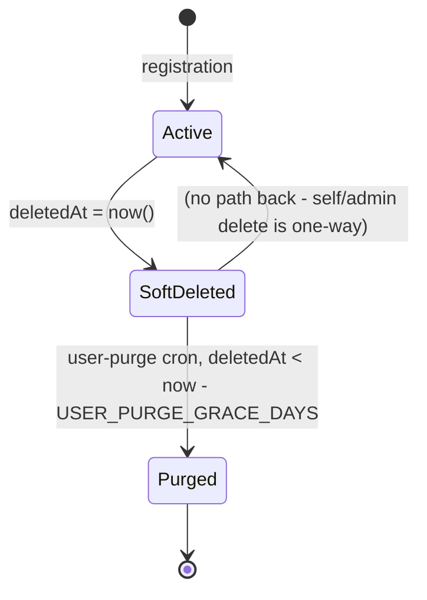
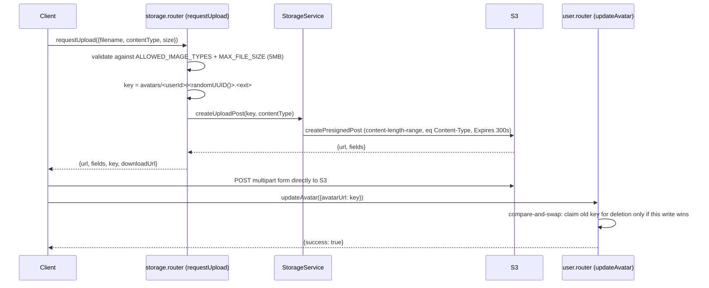

## The User model

`packages/database/prisma/schema/identity.prisma`:

```prisma
enum Role {
  USER
  ADMIN
}

model User {
  id              String    @id @default(cuid())
  email           String    @unique
  displayName     String?
  avatarUrl       String?
  passwordHash    String
  role            Role      @default(USER)
  emailVerified   Boolean   @default(false)
  failedAttempts  Int       @default(0)
  lockoutCount    Int       @default(0)
  lockedUntil     DateTime?
  deletedAt       DateTime?
  createdAt       DateTime  @default(now())
  updatedAt       DateTime  @updatedAt

  tenantId        String?
  tenant          Tenant?   @relation(fields: [tenantId], references: [id], onDelete: Restrict)

  tokens          Token[]
  rolePermissions RolePermission[]
  auditLogs       AuditLog[]
  notifications   Notification[]

  @@index([tenantId, deletedAt, createdAt(sort: Desc), id(sort: Desc)])
}
```

Notable choices baked into the schema:

- `Role` has exactly two values, `USER` and `ADMIN`. There is no `OWNER` role: the organization's owner is `Tenant.ownerId`, a column read by three guards, because folding it into `role` would make "promote to owner" a type-correct operation nothing should offer.
- `email` is globally unique and is the login identifier; it is **not** scoped per tenant.
- `tenantId` is nullable so a pre-tenancy seeded admin row backfills safely; the relation uses `onDelete: Restrict` so a `Tenant` cannot be deleted while it still has users (a `SET NULL` would strand fail-closed tenant-scoped queries with an unscoped user).
- `avatarUrl` actually stores the S3 object **key**, not a URL (see [Avatar handling](#avatar-handling-s3-presigned-post) below); the naming predates the presigned-POST flow.
- There is no separate `deletionStatus` enum. The entire deletion lifecycle is encoded in the single nullable `deletedAt` timestamp.
- `membershipEndedAt` is a **second, unrelated nullable timestamp**, and confusing the two is the mistake this line exists to prevent. `deletedAt` means the account is gone; `membershipEndedAt` means the account is fine but its holder no longer works at this organization. A removed member keeps their `tenantId`, stays visible in the admin list, and can be restored. See [Staff Invitations](/backend/staff-invitations/#three-states-three-different-actions).
- The composite index exists specifically to serve the admin user list, which filters `{ tenantId, deletedAt: null }` and orders by `createdAt DESC, id DESC` (keyset pagination) - the index makes that an index-ordered scan instead of a full table scan plus sort.

## Changing the account email

`EmailChangeService` (`apps/api/src/modules/auth/services/email-change.service.ts`) implements a verified two-step change of the login identity:

1. **`auth.requestEmailChange`** (authenticated) requires the sudo flag minted by `auth.confirmPassword` (the same 300 s per-session grant that gates OAuth unlink; a missing grant answers `FORBIDDEN`, which the settings form treats as "open the password dialog and retry"). When the account has an active second factor, a current TOTP or recovery code must ride along (`factorCode`), mirroring the password-reset gate. The new address is normalized, checked against disposable domains and the `EMAIL_IN_USE` pre-check, then a pending record `{ userId, newEmail }` is written to Redis keyed by `sha256(token)` with a 1-hour TTL (`EMAIL_CHANGE_TOKEN_TTL_MS`), one live record per user (a new request replaces the old one). The confirmation link is mailed to the **new** address (critical queue class) and a tripwire notice to the **old** address (non-critical class, the password-changed/OAuth-linked family).
2. **`auth.confirmEmailChange`** (public, per-IP rate limited) consumes the token via `GETDEL`, re-checks uniqueness (a `P2002` race maps to `EMAIL_IN_USE` like registration), then in one transaction flips `email` + `emailVerified: true` and invalidates outstanding `PASSWORD_RESET` and `EMAIL_VERIFICATION` tokens - links mailed to the old address must not survive the identity switch. Every session is then revoked (`deleteAllUserSessions` bumps the session epoch, the same fence password change rides), so the user signs in again with the new address. The audit row carries `before`/`after` email values (`auth.email.changed`).

Two deliberate cross-links:

- **Password change/reset cancels a pending email change** (`invalidatePending`): the tripwire tells a possible victim to rotate their password, and rotating it must strand any attacker-held confirmation link.
- **OAuth links do not move.** An `OAuthAccount` is keyed on the provider `sub`, deliberately not on email, so changing the account email neither moves nor removes a linked Google account; the settings card says so when a link exists.

## Deletion lifecycle

There is no separate state enum. The lifecycle is:



- **Active**: `deletedAt = null`.
- **Soft-deleted (pending purge)**: `deletedAt = <timestamp>`. Every soft-delete-guarded query throughout the codebase (login, password reset, lockout, admin actions) filters on a shared `notDeleted` predicate in `BaseRepository`, so a soft-deleted user is functionally locked out of everything immediately, not just after the eventual purge.
- **Purged**: the row is physically gone. Reached only via the `user-purge` cron.

### The `notDeleted` predicate is lint-enforced

`notDeleted` is a convention, not a mechanism: unlike the tenant boundary, no Prisma `$extends` layer injects `deletedAt` into a query, so a read that omits it returns soft-deleted rows and a bulk write mutates them, with every type and every test still green.

`repo/soft-deletable-tables-require-deleted-at` (`packages/eslint-plugin-repo`, `error` in `packages/eslint-config/nestjs.js`) closes that gap for the models that carry the column, `User` first among them. It reports a `findMany`, `findFirst`, `findFirstOrThrow`, `count`, `aggregate`, `groupBy`, `updateMany`, `updateManyAndReturn` or `deleteMany` on such a model's accessor (`<...>.user`) whose `where` mentions `deletedAt` nowhere at any depth and spreads no recognized soft-delete helper. `...this.notDeleted` is recognized, which is what keeps the rule quiet on the many call sites already written that way.

Singular selectors (`findUnique`, `update`, `delete`, `upsert`) stay out of the guarded set: their `where` is a unique selector, and demanding a second predicate in one reads as noise. Three exemptions are granted by `allowIn`, each named at its call site: the purge sweep, whose subject IS the soft-deleted rows, and the two organization-emptiness probes that must count every row because `User.tenantId`, like every tenant FK they count, is `onDelete: Restrict`.

See `packages/eslint-plugin-repo/docs/rules/soft-deletable-tables-require-deleted-at.md` for the options and the reasoning behind the exemption mechanism.

### Removal is not deletion

Ending somebody's membership of an organization is a **third**, reversible action that predates neither of the two above and does not appear in the diagram, because it does not touch `deletedAt` at all. `user.removeMember` stamps `membershipEndedAt` and revokes their auth state; `user.restoreMember` clears it. The row survives with its `tenantId` intact, so the removal is visible on the members list rather than invisible everywhere.

Enforcement lives at **login** and in **password reset**, and deliberately not in `auth.middleware`, which reads the session blob and never touches the database. Any future path that authenticates from a database row rather than from a session needs the clause too.

### Self-service deletion

`apps/api/src/modules/auth/services/account-deletion.service.ts`, `deleteAccount()`:

1. Rate-limited to 5 requests per 15 minutes per user.
2. Requires the caller's current password (`deleteAccountSchema = { password }`) - this re-confirms intent; there is no complexity check since it's an existing credential.
3. `userService.softDeleteById(userId)` sets `deletedAt: now()`. The underlying `UserRepository.softDelete` is guarded by the `notDeleted` filter and is idempotent: a double-delete matches zero rows, which is treated as success, not an error.
4. Audits `USER_ACCOUNT_DELETED` **before** teardown, so the trail captures the actor while the session is still live.
5. `revokeAuthState(userId)` - the same session/socket/permission-cache teardown used for role changes and logout-all (see [auth-and-sessions.md](/backend/auth-and-sessions/#session-revocation-on-role-change)).
6. Clears the session cookie and rotates the CSRF token so the caller is logged out by construction.

It **refuses** when the caller is the last live ADMIN of an organization that still has other members. Before invitations existed that organization was always empty so nobody could be harmed; once a founder can have colleagues, self-deleting would strand them with no admin, no owner and no in-app recovery. A sole user in an empty organization is unaffected, which keeps self-service deletion working for the only case that existed before.

The **grace period** is `USER_PURGE_GRACE_DAYS`, an env var defaulting to **30 days** (`apps/api/src/config/configuration.config.ts`): "Grace window for the user-purge cron: soft-deleted accounts older than this many days are hard-deleted (row + S3 objects). 0 means purge on the next sweep; the default gives 30 days to reverse an accidental deletion." There is currently no self-service "undo my deletion" endpoint; reversing a soft delete within the grace window would need a direct DB/admin intervention today.

### Admin deletion

`UserService.adminDeleteUser()` (`apps/api/src/modules/user/user.service.ts`): tenant-scoped (a cross-tenant `userId` matches zero rows and throws `NotFoundError`), refuses self-delete, and refuses deleting another `ADMIN` (the role check happens again inside the guarded `updateMany` to close a TOCTOU race window). Same `revokeAuthState` teardown as self-service delete. Audits `USER_ACCOUNT_ADMIN_DELETED`.

### No deletion confirmation email

There is currently **no "your account has been deleted" email template**. `packages/email/src/templates/` contains exactly four templates (verification, password-reset, password-changed, welcome) and none of them fire from the deletion path. This is an explicit gap, not an oversight to work around silently - if the product needs deletion confirmation email, it does not exist today.

## The purge cron

`apps/api/src/modules/user/user-purge.service.ts`:

```ts
@Cron(CronExpression.EVERY_DAY_AT_6AM, { name: 'user-purge' })
```

(Scheduled at 6 AM deliberately: the audit-log and notification retention sweeps already occupy the 4 AM and 5 AM slots - see [background-jobs.md](/backend/background-jobs/).)

Per sweep tick, oldest-`deletedAt`-first, capped at 500 rows:

1. `storageService.deletePrefix('avatars/<userId>/')` - deletes the user's S3 avatar objects **before** the DB row, so a crash mid-sweep never orphans S3 objects with no owning row.
2. A guarded `user.deleteMany({ where: { id } })`.

What cascades automatically via Prisma FK `onDelete: Cascade`: `Token`, `RolePermission`, `Notification`. What does **not** get deleted: `AuditLog` rows, whose FK is `onDelete: SetNull` - the compliance trail survives the user row's deletion, with `userId` set to null.

The code's own idempotency contract, quoted directly:

> "Idempotent by predicate (deletedAt < cutoff), so it races safely when @Cron fires on every replica; the guarded deleteMany on the row id makes the audit/metric side exactly-once across replicas."
>
> "Best-effort: sweep() NEVER throws; per-user failures are counted and deferred, a failed tick logs and returns 0."

A per-user failure (S3 or DB) increments a `userPurgeFailuresTotal` metric and defers that one row to the next tick; it does not abort the whole sweep. A successful purge writes an audit row (`USER_ACCOUNT_PURGED`, `userId: null` since the actor is the scheduler and the FK target is gone, `metadata.deletedAt` preserving the original soft-delete timestamp for the erasure trail).

The cron uses the **unscoped** Prisma client (`prismaService.client` directly, not the tenant-scoped extension) since `User` is a platform-global model - see [tenancy.md](/backend/tenancy/) for which models the extension auto-scopes and why `User` is not one of them.

## Self-signup creates an Organization (Tenant)

`RegisterService.runRegistrationTransaction()` (`apps/api/src/modules/auth/services/register.service.ts`) creates the `Tenant` row and the owning `User` row in a single Prisma transaction:

```ts
const tenant = await tx.tenant.create({ data: { name: localPart, slug } }); // slug = <local-part>-<8 hex>
await tx.user.create({ data: { ..., role: ROLES.ADMIN, tenantId: tenant.id } });
```

The registering user always becomes the new tenant's `ADMIN`. Full tenancy semantics (Tenant → Workspace, scoping, the Prisma extension) are covered in [tenancy.md](/backend/tenancy/); this is just the entry point.

## Avatar handling (S3 presigned POST)

Router: `apps/api/src/modules/storage/storage.router.ts`. Shared contracts: `packages/shared/src/schemas/storage.ts`.



Key details:

- `MAX_FILE_SIZE = 5 * 1024 * 1024` (5 MB), enforced both in the zod input schema and again by S3 itself via the presigned POST's `content-length-range` condition (defense against a client that lies about `size` in the request).
- `ALLOWED_IMAGE_TYPES`: `image/png`, `image/jpeg`, `image/webp`, `image/gif`. **SVG is deliberately excluded** - an SVG served inline from the app's own origin can carry `<script>` and become a stored-XSS vector.
- The stored key's extension is derived from the validated MIME type map, **never** from the client-supplied filename.
- Key convention: `avatars/<userId>/<crypto.randomUUID()>.<ext>`. This is validated structurally on the way back in via `avatarKeySchema`, a regex anchored and case-sensitive enough to make `..` path traversal, extra path segments, and uppercase variants all fail parsing.
- The presigned POST itself expires after 300 seconds; a presigned **download** URL (`getUrl`) defaults to a 1-hour expiry.
- Ownership is enforced on every read/delete: `storage.router.ts`'s `getUrl()` and `deleteFile()` both check `input.key.startsWith('avatars/<callerId>/')` and throw `FORBIDDEN` otherwise.
- Swapping the avatar (`user.router.ts`'s `updateAvatar`) is a compare-and-swap write: it only claims the _old_ key for deletion if this caller's write actually won the race, preventing two concurrent avatar updates from both trying to delete the same old S3 object. The old object is skipped (not deleted) if it's an external `http(s)://` URL rather than a server-issued key.

## Roles, permissions, and admin surfaces

See [auth-and-sessions.md](/backend/auth-and-sessions/#roles-and-permissions) for the full role/permission model. The admin-facing procedures live on `user.router.ts`, all class-gated by `AuthMiddleware`:

| Procedure         | Type     | Input                                       | Output                    | Extra guard                                |
| ----------------- | -------- | ------------------------------------------- | ------------------------- | ------------------------------------------ |
| `me`              | Query    | -                                           | `userProfileOutput`       | -                                          |
| `updateAvatar`    | Mutation | `{ avatarUrl: avatarKeySchema.nullable() }` | `{success:true}`          | `IdempotencyMiddleware`                    |
| `listUsers`       | Query    | `{ cursor?, limit: 1-100 default 50 }`      | `adminUserListPageOutput` | `AdminMiddleware`                          |
| `unlockUser`      | Mutation | `{ userId }`                                | `{success:true}`          | `AdminMiddleware`, `IdempotencyMiddleware` |
| `updateUserRole`  | Mutation | `{ userId, role }`                          | `{success:true}`          | `AdminMiddleware`, `IdempotencyMiddleware` |
| `adminDeleteUser` | Mutation | `{ userId }`                                | `accountDeletedOutput`    | `AdminMiddleware`, `IdempotencyMiddleware` |

There is deliberately no `user.sessions`. It existed alongside `sessions.list` and returned the RAW Redis session id, while `sessions.list` was built to return an opaque sha256 handle precisely so a value seen in devtools, logs or the query cache can never name a Redis key. Two procedures on the same surface meant the older one bypassed the contract the newer one exists to enforce, so it was removed; `sessions.list` is the only active-sessions read.

`userProfileOutput` (`packages/shared/src/schemas/user.ts`) never carries `passwordHash` or the lockout counters - the schema strips anything not explicitly listed. `adminUserListPageOutput` uses cursor (keyset) pagination: `nextCursor` is `null` on the last page. `total` is counted **only on the first page** (the request with no `cursor`) and is `null` on every page after it - a COUNT over one traversal's predicate returns the same number for the whole traversal, so re-running it per page paid for a footer that had not changed. The web carries the first page's answer forward with `useCarriedTotal`; the rule itself lives in `BaseRepository.pageWithTotal` and applies identically to every other list built on it.

**Audit-coverage gap worth knowing about**: `updateRole` never calls the audit logger. There is no `AUDIT_ACTIONS` entry for a role change at all today (`packages/shared/src/audit/index.ts` has entries for account deletion and purge, but not for role updates). If you need an audit trail of privilege changes, this is a real gap to fill, not something already covered elsewhere. See [audit-logging.md](/backend/audit-logging/).

## GDPR data export

`apps/api/src/modules/data-export/data-export.router.ts` exposes a single `dataExport.download` query, `AuthMiddleware`-gated, strictly scoped to `ctx.user.id` (no ID input parameter, so there is no IDOR surface). It is explicitly **not rate-limited** - the module deliberately avoids importing `AuthModule` to keep its dependency-cycle-breaker pattern, and tRPC procedures sit outside the Nest `ThrottlerGuard` regardless (see [auth-and-sessions.md](/backend/auth-and-sessions/#rate-limiting)). This is flagged in-code as a known gap for a fork that adds heavier export sections.

## Modifying this area

- Changing the purge grace window: set `USER_PURGE_GRACE_DAYS` (env var, `Joi.number().integer().min(0)`, default 30). No floor beyond zero, so an operator can trigger purge-on-next-sweep deliberately.
- Adding a deletion confirmation email: add a template under `packages/email/src/templates/`, a job type in `email-delivery.constants.ts`/`email-delivery.types.ts`, and call it from `account-deletion.service.ts` after the soft delete succeeds (see [mail.md](/backend/mail/) for the queue wiring pattern).
- Inspecting the schema locally: `pnpm --filter @repo/database db:studio`.
- Running the purge sweep manually in a test: call `UserPurgeService.sweep()` directly rather than waiting for `@Cron` - the same pattern every cron in this repo uses for testability.
- Running the user/auth test suite: `pnpm --filter @repo/api test`.
