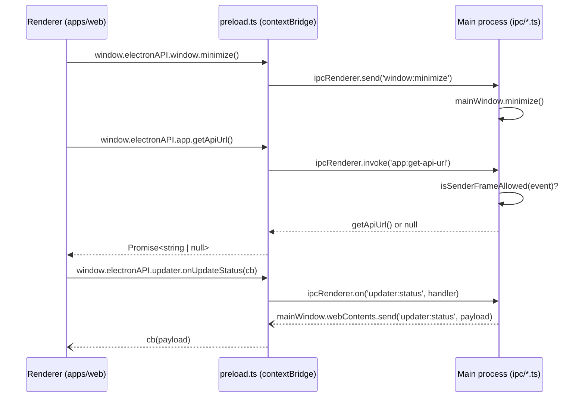
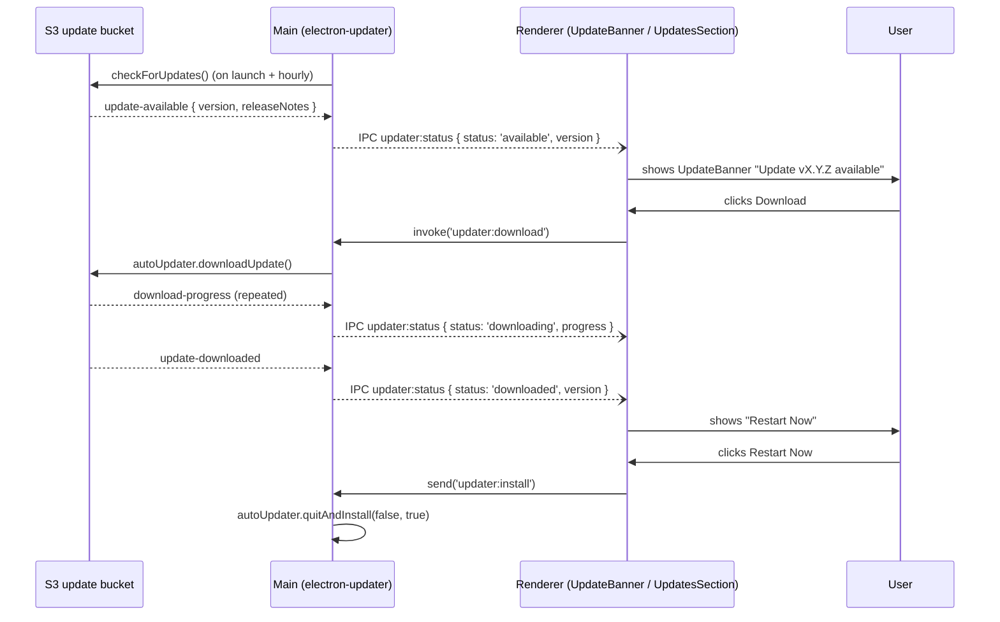

`apps/desktop` is the Electron shell. It has no UI of its own: the renderer it
loads is `apps/web`'s built SPA (see "Renderer" below). Its own source is
entirely main-process (Node) code under `apps/desktop/src/main/`.

## Structure

```
apps/desktop/
  src/main/
    index.ts            # app entry: single-instance lock, crash reporter, bootstrap()
    window.ts            # createMainWindow(): BrowserWindow options, CSP, bounds restore
    security.ts           # enforceSingleInstance, hardenWindow, isSenderFrameAllowed
    protocol.ts            # app:// custom protocol (privileged scheme + file server)
    api-url.ts               # resolves + validates the API_URL env var
    preload.ts                # contextBridge surface -> window.electronAPI
    ipc-handlers.ts            # registers/cleans up every ipc/*.ts handler module
    updater.ts                  # electron-updater wiring (S3 provider)
    ipc/
      app.ts                     # app:get-version, app:get-api-url
      window.ts                   # window:minimize/maximize/close/is-maximized
      store.ts                     # store:get/set/delete (electron-store, schema-validated)
      dialog.ts                     # dialog:open-file/save-file/open-directory
      notification.ts                # notification:show (native OS notification)
      updater.ts                     # updater:check/download/install/get-channel/set-channel
  electron-builder.cjs          # packaging config (S3 publish target from env, per-OS build)
  resources/                     # icon.png, icon.ico
  scripts/
    dev.mjs                       # starts API + Vite dev servers, waits for both, launches Electron
    copy-renderer.mjs               # copies apps/web/dist into dist/renderer for packaging
    generate-placeholder-icons.mjs
```

## Renderer: apps/web's build, not a separate app

There is no `apps/desktop/src/renderer/` source tree. In development,
`scripts/dev.mjs` starts the API (`pnpm --filter @repo/api dev`) and the Vite
dev server (`pnpm --filter @repo/web dev`, port 5173), waits for both `HEAD`
requests to succeed, then launches `electron .` with `NODE_ENV=development`;
`window.ts` points the `BrowserWindow` at `http://localhost:5173` in that
mode. In production, `scripts/copy-renderer.mjs` copies `apps/web/dist` into
`apps/desktop/dist/renderer` as a build step, and `protocol.ts` serves those
files over a custom `app://` scheme (`app://app/index.html`), this is why
`apps/web/vite.config.ts` sets `base: './'` (see the web architecture doc):
asset URLs must be relative to resolve correctly under a non-HTTP origin.

## Main process bootstrap (`src/main/index.ts`)

1. `enforceSingleInstance()` (`security.ts`, wraps
   `app.requestSingleInstanceLock()`), a second launch quits immediately
   after focusing the existing window instead of racing on `electron-store`
   writes.
2. `crashReporter.start(...)`: records native crashes to disk;
   `submitURL`/`uploadToServer` are wired from an optional
   `CRASH_REPORTER_URL` env var (empty/off by default, no crash-reporting
   backend is configured yet).
3. `registerAppProtocol()` (`protocol.ts`), registers the `app://` scheme as
   privileged (`standard`, `secure`, `supportFetchAPI`, `corsEnabled`).
   **Must** happen before `app.whenReady()`.
4. `app.whenReady().then(bootstrap)`:
   - `registerAppHandlers()` (from `ipc/app.ts`) is registered **before** the
     window is created, so the renderer can query `app:get-api-url` as soon
     as it loads.
   - `createMainWindow(isDev)` (`window.ts`) builds the `BrowserWindow`.
   - `hardenWindow(mainWindow)` (`security.ts`) applies navigation/popup/
     permission hardening (see "Security hardening" below).
   - `registerIpcHandlers(mainWindow)` (`ipc-handlers.ts`) wires every
     remaining IPC module and calls `initializeAutoUpdater(mainWindow, isDev)`.
5. `app.on('before-quit', cleanupIpcHandlers)` removes every registered
   handler/listener on shutdown.

## Window management (`src/main/window.ts`)

`createMainWindow(isDev)`:

- Restores saved bounds from `electron-store` (`ipc/store.ts`'s
  `windowBoundsSchema`, zod-validated with `.finite()` numbers), but only if
  `validateBounds()` confirms the saved position is still on-screen
  (tolerant of up to 100px off a display's work area), a display
  disconnected since the last run falls back to the 1200x800 default instead
  of opening off-screen.
- `frame: false`: the window is frameless; `TitleBar` (in `apps/web`'s
  `features/desktop`) draws custom minimize/maximize/close controls over IPC.
- `webPreferences`: `nodeIntegration: false`, `contextIsolation: true`,
  `sandbox: true`, `webSecurity: true`, `allowRunningInsecureContent: false`,
  `experimentalFeatures: false`, `webviewTag: false`,
  `nodeIntegrationInSubFrames: false`, `nodeIntegrationInWorker: false`: the
  full hardened-Electron checklist stated explicitly (even where some are
  already the platform default) "so a 'we'll just turn this on for one
  feature' regression" doesn't slip through unnoticed.
- Sets up a per-session Content-Security-Policy via
  `session.defaultSession.webRequest.onHeadersReceived`: production CSP is
  `script-src 'self'`, `connect-src 'self' <apiUrl> <wsUrl>`,
  `object-src 'none'`, `frame-src blob:`, `default-src 'self'`; dev mode
  additionally allows `http://localhost:5173` and `ws://localhost:5173` plus
  `'unsafe-inline'` script-src for Vite HMR.
- Saves bounds on close: `close` is intercepted (`event.preventDefault()`),
  bounds are written to the store asynchronously, and only then is
  `mainWindow.destroy()` called, this avoids a race where the process exits
  before the JSON store file flushes.
- Loads `http://localhost:5173` in dev, `app://app/index.html` in production.

## Security hardening (`src/main/security.ts`)

- `hardenWindow(window)`: blocks all popups via `setWindowOpenHandler`
  (allows only same-origin/allowed navigation targets; anything else with an
  `http(s)` URL opens in the OS default browser via `shell.openExternal`,
  everything else is denied outright); hard-denies `will-navigate` away from
  the allowed origin set (`app://app`, plus `http://localhost:5173` only in
  development); prevents `will-attach-webview` (belt-and-braces ,
  `webviewTag` is already `false`); denies every permission-request prompt
  (camera, mic, geolocation, ...) by default.
- `isSenderFrameAllowed(event)`: the first line of defense inside every
  `ipcMain.handle`, checking the invoking frame's origin against the same
  allowlist. `ipc/app.ts`'s handlers use it explicitly
  (`if (!isSenderFrameAllowed(event)) return null;`); it exists so that even
  a renderer that somehow loaded an attacker-controlled page (despite the
  `will-navigate` guard) cannot successfully invoke privileged IPC.

## IPC surface

The preload script (`src/main/preload.ts`) is the only bridge between the
sandboxed renderer and the main process: it calls
`contextBridge.exposeInMainWorld('electronAPI', electronAPI)`, so the
renderer only ever sees `window.electronAPI`, never raw `ipcRenderer`. The
renderer-side type of this object is mirrored independently in
`apps/web/src/types/electron.d.ts` as `IElectronAPI`. That file's `Window`
augmentation (`electronAPI?: IElectronAPI`) is wrapped in `declare global`
because the file itself has imports/exports (making it a module): without
`declare global`, the `Window` interface merge would only be visible inside
that file instead of project-wide. The two `ElectronAPI` shapes (main-process
preload and renderer `.d.ts`) are maintained by hand in parallel today ,
there is no generated or shared type for the IPC contract itself, only for
the updater payload (`@repo/shared/desktop`).



Full handler inventory (channel -> module):

| Namespace      | Channels                                                                                                                                                               | Module                         |
| -------------- | ---------------------------------------------------------------------------------------------------------------------------------------------------------------------- | ------------------------------ |
| `window`       | `window:minimize`/`maximize`/`close` (send), `window:is-maximized` (invoke), `window:maximized-change` (main -> renderer event)                                        | `ipc/window.ts`                |
| `store`        | `store:get`/`set`/`delete` (invoke)                                                                                                                                    | `ipc/store.ts`                 |
| `dialog`       | `dialog:open-file`/`save-file`/`open-directory` (invoke)                                                                                                               | `ipc/dialog.ts`                |
| `app`          | `app:get-version`, `app:get-api-url` (invoke, frame-origin checked)                                                                                                    | `ipc/app.ts`                   |
| `updater`      | `updater:check`/`download` (invoke), `updater:install` (send/fire-and-forget), `updater:get-channel`/`set-channel` (invoke), `updater:status` (main -> renderer event) | `ipc/updater.ts`, `updater.ts` |
| `notification` | `notification:show` (invoke, native OS notification)                                                                                                                   | `ipc/notification.ts`          |

Notable hardening details:

- **`store` is an explicit key allowlist**, not a free-form key-value store.
  `ipc/store.ts` defines `STORE_VALUE_SCHEMAS` (zod schemas for
  `windowBounds`, `updateChannel`, `launchOnStartup`, `minimizeBehavior`); a
  key not in that map is rejected outright, and every `store:set` write is
  `safeParse`'d against its schema before being persisted. The renderer's
  `preload.ts` types (`StoreKey`, `StoreValues`) are derived from this exact
  map, so a typo'd key fails to compile on the renderer side, not just at
  runtime.
- **`dialog` sanitizes its options** (`sanitizeOptions()` in `ipc/dialog.ts`)
  to a narrow allow-shape (`title`, `defaultPath`, `filters`, `buttonLabel`)
  before passing them to Electron's native dialog, rather than trusting
  whatever object the renderer sends.
- **`notification:show` clamps title/body length** (256/1024 chars) and
  requires a non-empty title, and its click handler re-focuses the main
  window.
- `electron-store` is ESM-only (v9+) while the desktop main bundle compiles
  to CommonJS, so `ipc/store.ts` loads it via a lazy `await import(...)`
  (cached after first resolution) rather than a static `require`; the
  preload's type-only import of it uses TypeScript's `resolution-mode:
"import"` attribute to keep that working under `module: node16` without a
  runtime import (the sandboxed preload cannot `require()` workspace
  packages at all).

## Auto-updater: S3-based, manual download/install

`electron-updater`'s generic **S3 provider** is configured in
`apps/desktop/electron-builder.cjs`, which builds the `publish` block from the
environment through `scripts/update-publish.mjs`:

```js
publish: {
  provider: 's3',
  bucket: process.env.S3_UPDATE_BUCKET,
  region: process.env.S3_UPDATE_REGION,
  path: '/releases',
  acl: 'public-read',
},
generateUpdatesFilesForAllChannels: true,
```

The config is JavaScript because electron-builder does not expand `${NAME}` in
the publish block: the old `electron-builder.json` shipped an `app-update.yml`
naming a bucket literally called `${S3_UPDATE_BUCKET}`. Whether a
build may run without the two variables:

| Build                                                                | Both set              | Neither set                                                                                           | Only one set |
| -------------------------------------------------------------------- | --------------------- | ----------------------------------------------------------------------------------------------------- | ------------ |
| `--publish always` / `onTag` / `onTagOrDraft`                        | S3 feed               | fails before packaging                                                                                | fails        |
| no `--publish` flag (CI, a git tag and `release` publish implicitly) | S3 feed               | fails before packaging                                                                                | fails        |
| `--publish never`                                                    | S3 feed, not uploaded | packages with **no** `app-update.yml`: the updater reports an error instead of polling a wrong bucket | fails        |

So a local package without a bucket needs an explicit `--publish never`, and a
build that ships an update feed always names a real one.

This is deliberately **not** GitHub Releases, release artifacts and the
update manifests (`latest-mac.yml`, `alpha-mac.yml`, `beta-mac.yml`, etc.,
visible in `apps/desktop/release/` from a local package build) are published
to an S3 bucket instead.

`src/main/updater.ts`'s `initializeAutoUpdater(mainWindow, isDev)`:

- No-ops entirely in dev mode.
- **`autoUpdater.autoDownload = false` and `autoInstallOnAppQuit = false` ,
  both OFF.** The code comment is explicit about why: with unsigned S3
  binaries (see "Code signing" below), auto-download plus install-on-quit
  would silently install an artifact the OS cannot verify. The user must
  explicitly trigger both the download (renderer "Download" button ->
  `updater:download` IPC) and the install (renderer "Restart Now" button ->
  `updater:install` IPC, which calls `autoUpdater.quitAndInstall(false,
true)`).
- Reads the persisted channel (`stable` or `beta`, `UPDATE_CHANNELS` in
  `@repo/shared/desktop`) from `electron-store` and sets
  `autoUpdater.channel` before the first check.
- Forwards every `electron-updater` event
  (`checking-for-update`/`update-available`/`update-not-available`/
  `download-progress`/`update-downloaded`/`error`) to the renderer as a single
  typed `updater:status` IPC event, shaped by `UpdateStatusPayload`
  (`@repo/shared/desktop`: the one contract shared by the emitter, the
  preload bridge, and the renderer's `useUpdateStore`, so the payload shape
  cannot drift between the three).
- Checks for updates once on launch and then every hour
  (`UPDATE_CHECK_INTERVAL_MS = 60 * 60 * 1000`).
- Logs to both stdout and a file (`app.getPath('logs') + '/updater.log'`) via
  `@repo/shared/logger`'s `createLogger`.



The channel picker (`UpdatesSection` in `apps/web`, `useUpdateStore.selectChannel`)
writes optimistically, persists via `updater:set-channel` IPC, and rolls back
with a toast if the main-process write fails, so the renderer's displayed
channel can never diverge from what's actually persisted.

## Packaging and build

```bash
pnpm --filter @repo/desktop dev              # tsc -p tsconfig.build.json && node scripts/dev.mjs
pnpm --filter @repo/desktop build            # tsc -p tsconfig.build.json && copy-renderer.mjs
pnpm --filter @repo/desktop package          # build, then electron-builder (current OS)
pnpm --filter @repo/desktop package:mac      # build, then electron-builder --mac
pnpm --filter @repo/desktop package:win      # build, then electron-builder --win
pnpm --filter @repo/desktop package:linux    # build, then electron-builder --linux
pnpm --filter @repo/desktop package:mac --publish never   # local build, no update feed needed
```

Without `S3_UPDATE_BUCKET` and `S3_UPDATE_REGION` the `package*` scripts fail
unless `--publish never` is passed (see the auto-updater section above).

`electron-builder.cjs` targets: macOS `dmg` + `zip` (`hardenedRuntime: true`,
`gatekeeperAssess: false`), Windows `nsis` (customizable install dir, desktop

- start-menu shortcuts), Linux `AppImage`. `electronFuses` locks down several
  runtime capabilities in the packaged binary regardless of code signing:
  `enableNodeCliInspectArguments: false`, `enableNodeOptionsEnvironmentVariable:
false`, `onlyLoadAppFromAsar: true`, `runAsNode: false`,
  `enableCookieEncryption: true`, `grantFileProtocolExtraPrivileges: false`.

## Code signing: open decision, currently unsigned

This is explicitly unresolved in the current tree, not an oversight:

- macOS: `"identity": null` and `"dmg": { "sign": false }`: no Developer ID,
  no notarization.
- Windows: `signtoolOptions: { signingHashAlgorithms: null, sign: null }`: no
  Authenticode signing.
- The `updater.ts` comment (quoted above) states directly that
  `autoDownload`/`autoInstallOnAppQuit` are OFF **specifically because** the
  binaries are unsigned, turning on silent auto-update before signing lands
  would let the app install an artifact the OS itself cannot verify.

Until code signing is added (tracked as an open item in the project's audit
history, not yet scheduled), every release requires the user to manually
approve an unsigned/unnotarized binary at first launch (Gatekeeper on macOS,
SmartScreen on Windows), and the manual download/install flow above stays the
correct posture, do not flip `autoDownload`/`autoInstallOnAppQuit` back on
without addressing signing first.
