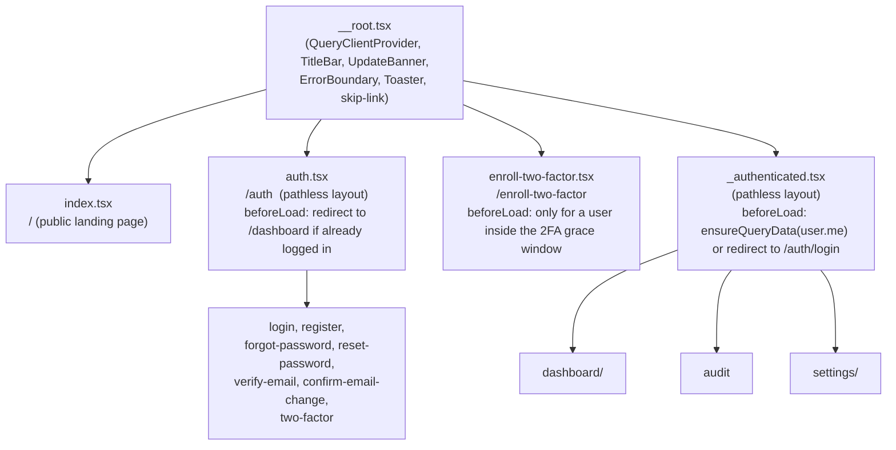

`apps/web` is a Vite + React 19 single-page app. It is loaded two ways in this
monorepo: as a normal browser SPA (served by nginx in production, see
`apps/web/Dockerfile` and `apps/web/nginx.conf`), and as the renderer process
inside the Electron shell in `apps/desktop`. Several pieces of this
architecture exist specifically to make that second mode work.

## Vite configuration

File: `apps/web/vite.config.ts`.

```ts
export default defineConfig({
  base: './',
  plugins: [
    tanstackRouter({ target: 'react', autoCodeSplitting: true }),
    react(),
    tailwindcss(),
  ],
  ...
});
```

Key points:

- **`base: './'` is the Electron gotcha.** The packaged desktop app serves the
  built SPA from a custom `app://` protocol (see `apps/desktop/src/main/protocol.ts`),
  not from a web server root. Relative asset paths (`./assets/...`) resolve
  correctly under `app://app/index.html`; an absolute `base: '/'` would break
  every asset reference in the packaged app. The CI e2e job instead builds with
  `vite build --base=/` because that job serves the build with `vite preview`
  over plain HTTP where an absolute base is fine and deep-linked SPA routes
  need it.
- **`@tanstack/router-plugin/vite`** with `autoCodeSplitting: true` generates
  `src/routeTree.gen.ts` from the file-based routes under `src/routes/`. This
  generated file must never be hand-edited; the route tree is described below.
- **Dev/preview API proxy.** Both the `server.proxy` and `preview.proxy` blocks
  forward `/trpc`, `/api`, and `/socket.io` to `http://localhost:3000` (the
  NestJS API). This keeps the web app talking to the API same-origin via
  relative URLs in the browser, avoiding a CORS hop. In packaged Electron mode
  there is no dev server or proxy, the renderer instead resolves an absolute
  API URL via IPC (see "Electron detection and API URL resolution" below).
- **Manual chunking.** `manualChunks` pins `react`/`react-dom`/`scheduler` into
  a stable `vendor-react` chunk so returning visitors keep a warm cache for the
  framework across app deploys; nothing else is split.
- **Path aliases.** `@` → `apps/web/src`, `@api` → `apps/api/src` (used only
  for importing the generated tRPC `AppRouter` **type**, never runtime code).

## TanStack Router: file-based routing

Routes live under `apps/web/src/routes/` and are compiled into
`apps/web/src/routeTree.gen.ts` by the Vite plugin. The route tree:



Route files present in the tree today (repo-relative, under `apps/web/src/routes/`).
Co-located `.test.tsx` siblings are omitted from the table; most guarded routes
have one.

| File                                 | Path                         | Notes                                                                                         |
| ------------------------------------ | ---------------------------- | --------------------------------------------------------------------------------------------- |
| `__root.tsx`                         | (layout)                     | App shell, theme bootstrap, error boundary                                                    |
| `index.tsx`                          | `/`                          | Public landing page                                                                           |
| `auth.tsx`                           | `/auth`                      | Pathless auth layout, redirect-if-logged-in guard                                             |
| `auth/login.tsx`                     | `/auth/login`                | `validateSearch` for the post-login redirect target                                           |
| `auth/register.tsx`                  | `/auth/register`             |                                                                                               |
| `auth/forgot-password.tsx`           | `/auth/forgot-password`      |                                                                                               |
| `auth/reset-password.tsx`            | `/auth/reset-password`       | requires `?token=` (zod/mini `validateSearch`)                                                |
| `auth/verify-email.tsx`              | `/auth/verify-email`         | optional `?token=` and `?emailSent=`                                                          |
| `auth/confirm-email-change.tsx`      | `/auth/confirm-email-change` | requires `?token=`                                                                            |
| `auth/two-factor.tsx`                | `/auth/two-factor`           | the TOTP / recovery-code challenge between password and session                               |
| `enroll-two-factor.tsx`              | `/enroll-two-factor`         | outside the authenticated layout: a user in the 2FA grace window is not through the guard yet |
| `_authenticated.tsx`                 | (pathless layout)            | Auth guard, shell, `pendingComponent` + `errorComponent`                                      |
| `_authenticated/dashboard/index.tsx` | `/dashboard`                 |                                                                                               |
| `_authenticated/audit.tsx`           | `/audit`                     | Audit log browser                                                                             |
| `_authenticated/settings/index.tsx`  | `/settings`                  | `validateSearch` picks the open tab                                                           |

See [features-inventory.md](/frontend/features-inventory/) for the
domain-by-domain list of the features behind these routes, which a lint-meta
rule keeps complete.

### Root layout (`src/routes/__root.tsx`)

`createRootRouteWithContext<IRouterContext>()` types the router context as
`{ queryClient: QueryClient }` (the same singleton exported from
`src/lib/trpc.ts`, injected in `src/main.tsx`'s `createRouter({ routeTree,
context: { queryClient } })`). The root component:

- Applies the theme (`applyTheme`, `applyColorTheme` from `src/lib/theme.ts`)
  and subscribes to OS theme changes on mount.
- Calls `initUpdateListener()` (no-op outside Electron) to wire the desktop
  auto-updater IPC events into `useUpdateStore`.
- Wraps everything in `QueryClientProvider`.
- Renders `<TitleBar />` (Electron-only custom window chrome) and
  `<UpdateBanner />` (Electron-only update prompt) above the routed content.
- Wraps `<Outlet />` in `@repo/ui`'s `ErrorBoundary`, forwarding caught errors
  to `captureException` (Sentry facade, see `src/lib/error-reporting.ts`).
- Defines `errorComponent: RootErrorComponent` for router-level failures
  (loader/`beforeLoad`/render throws that never reach the `ErrorBoundary`),
  which also reports via `captureException`.
- Renders a visually-hidden "Skip to main content" link before the chrome, and
  `<Toaster />` (Sonner) at the very end.

### Auth guards and redirects

Two layout routes gate access using the **same** query as their guard, so the
`user.me` cache entry is shared instead of duplicated:

- **`src/routes/auth.tsx`** (`/auth` pathless layout): in `beforeLoad`, calls
  `context.queryClient.ensureQueryData(trpc.user.me.queryOptions())` with
  `retry: false` and `staleTime: USER_ME_STALE_TIME` (5 minutes, from
  `src/hooks/use-auth.ts`). If the call succeeds (user is logged in), it throws
  `redirect({ to: '/dashboard' })`. Any thrown error other than a `redirect`
  (i.e. the user is not authenticated) is swallowed and the request falls
  through to render the auth pages.
- **`src/routes/_authenticated.tsx`** (pathless layout wrapping `/dashboard`
  and `/settings`): the inverse guard. `beforeLoad` calls the same
  `ensureQueryData(trpc.user.me.queryOptions())`. On error, it checks
  `isUnauthorizedError(error)` (from `src/lib/trpc.ts`, matches a tRPC
  `UNAUTHORIZED`/401 rejection). Only a **confirmed** unauthorized bounces the
  user to `/auth/login` with `search: { redirect: location.href }` (an
  open-redirect guard on the login route then validates that value, see
  `src/routes/auth/login.tsx`'s `safeRedirect`). Any other error (network
  blip, 500) is rethrown so the route's `errorComponent` renders with a retry
  affordance instead of bouncing a valid session out.
  - Also defines `pendingComponent` (a centered `Spinner`) and
    `notFoundComponent` (a "Page not found" card linking back to
    `/dashboard`).
  - The rendered layout (`AuthenticatedLayout`) wires `useSocket(isAuthenticated)`
    (connects/disconnects Socket.io based on auth state), reads
    `useUIStore`'s `sidebarCollapsed`, and renders `AppSidebar` +
    `SidebarInset` (header with `ConnectionIndicator` and `NotificationBell`)
    around a per-route `ErrorBoundary`-wrapped `<Outlet />`.

Both guards deliberately use `ensureQueryData` (not a bare `useQuery` in a
component) so the redirect decision happens **before** the route renders,
preventing an authenticated-only flash or a login-page flash.

## TanStack Query + tRPC client wiring

File: `apps/web/src/lib/trpc.ts`.

- `queryClient` is a single `QueryClient` exported from this module and reused
  everywhere (router context, `QueryClientProvider`, IPC/socket cache writes).
  Its `QueryCache.onError` is centralized: `UNAUTHORIZED` errors are ignored
  (routing handles those), everything else is logged, reported via
  `captureException`, and, only if the query already had data on screen (a
  background refetch, not the initial load), surfaced as a Sonner toast.
  Default `staleTime` is 60s with `refetchOnWindowFocus: false`.
- The tRPC client (`createTRPCClient<AppRouter>`) is **lazily constructed**
  (`getTrpcClient()`), because in Electron mode the backend URL is only known
  after `initElectron()` resolves in `main.tsx`. It uses `httpBatchLink` with:
  - `url: getTrpcUrl()`: relative `/trpc` in web mode, absolute
    `${apiUrl}/trpc` in Electron mode (see `src/lib/electron.ts`).
  - `transformer: superjson`: **must match** `TRPCModule.forRoot`'s
    transformer on the API side (`apps/api/src/app.module.ts`).
  - `headers()`: attaches the CSRF header (`CSRF_HEADER` from
    `@repo/shared/constants`) fetched via `getCsrfToken()`.
  - `fetch`: routed through `fetchWithCsrfRetry` (see `src/lib/csrf.ts`),
    which retries once on a 403 whose body mentions "csrf" after resetting and
    refetching the token.
- `trpc` (the object components import) is a `Proxy` around a lazily-created
  `createTRPCOptionsProxy<AppRouter>()`, so `trpc.user.me.queryOptions()` etc.
  are always available even before the underlying client exists yet.
- `isUnauthorizedError(error)` is the one place that inspects a tRPC error for
  `UNAUTHORIZED`/401; both auth-route guards and query-cache handling use it
  instead of re-deriving the check.
- `resetCsrfToken` is re-exported from `csrf.ts` here so existing consumers can
  keep importing it from `trpc.ts`.

### CSRF token handling (`src/lib/csrf.ts`)

`getCsrfToken()` caches the **in-flight promise** (not the resolved string) so
concurrent first callers share one request to `CSRF_TOKEN_PATH`. Credentials
mode is `'include'` in Electron (cross-origin to the external API) or
`'same-origin'` in web mode. `fetchWithCsrfRetry` performs the request, and on
a 403 whose parsed error message contains "csrf" it resets the cached token,
fetches a fresh one, and retries the original request once with the new
header. `resetCsrfToken()` must be called after login/logout/register so the
next request uses a token tied to the new session, every auth mutation hook
in `features/auth` and `features/settings/components/DangerZoneSection` does
this.

### Electron detection and API URL resolution (`src/lib/electron.ts`)

`IS_ELECTRON` is `typeof window !== 'undefined' && !!window.electronAPI` (the
bridge the preload script injects, see the desktop doc). `initElectron()`
(called once in `main.tsx` before the first render) asks the main process for
the API URL over IPC (`window.electronAPI.app.getApiUrl()`) and caches it;
`getApiBaseUrl()`, `getTrpcUrl()`, and `getSocketUrl()` all read that cache
(web mode returns relative/`undefined` values instead, letting the browser
proxy or auto-detect).

### Structured tRPC errors (`src/lib/trpc-errors.ts`)

`getAppErrorCode(error)` duck-types a tRPC client error's `data.appCode` field
against the `AppErrorCode` enum from `@repo/shared/errors` (set by the API's
`trpc.error-handler.ts`). Feature hooks match on this code (e.g.
`AppErrorCode.ACCOUNT_LOCKED`, `AppErrorCode.INVALID_CREDENTIALS`) instead of
substring-matching error messages.

## Zustand stores

All stores live in `apps/web/src/stores/` and use the `devtools` middleware
(named actions like `'ui/setTheme'` show up in Redux DevTools). None of them
call tRPC directly, they hold client-only UI/session state, or main-process
IPC state.

| Store            | File                     | Persisted?                                    | Purpose                                                                                                                                                                                                                                                                                                                                                                                             |
| ---------------- | ------------------------ | --------------------------------------------- | --------------------------------------------------------------------------------------------------------------------------------------------------------------------------------------------------------------------------------------------------------------------------------------------------------------------------------------------------------------------------------------------------- |
| `useUIStore`     | `stores/ui-store.ts`     | Yes (`persist`, key `ui-store`, localStorage) | `theme` (`light`/`dark`/`system`), `colorTheme` (one of `@repo/ui`'s `ColorTheme` values), `sidebarCollapsed`. Setting theme/colorTheme also calls `applyTheme`/`applyColorTheme` synchronously.                                                                                                                                                                                                    |
| `useSocketStore` | `stores/socket-store.ts` | No                                            | Ephemeral: Socket.io `status` (`disconnected`/`connecting`/`connected`/`reconnecting`) and a capped (`MAX_ACTIVITIES = 20`) live `activities` feed. Notifications are **not** stored here, Postgres is their source of truth via `trpc.notifications.list`; `useSocket` merges live events straight into that TanStack Query cache entry instead.                                                   |
| `useUpdateStore` | `stores/update-store.ts` | No (synced from Electron IPC)                 | Electron auto-updater state: `status`, `version`, `releaseNotes`, `progress`, `error`, `channel`, `dismissed`. `selectChannel()` does an optimistic set + IPC persist + rollback-with-toast on failure. `initUpdateListener()` (called once from `__root.tsx`) is a no-op outside Electron; inside it, it hydrates the channel from `electron-store` and subscribes to `updater:status` IPC events. |

`ui-store`'s persisted `theme` is also read synchronously (outside React) by
`apps/web/public/theme-boot.js`, an external script tag in `index.html` that
applies the `dark` class before first paint to avoid a flash of the wrong
theme; it duplicates the localStorage-read logic because it must run before
any JS module (including Zustand) is parsed, and an external script (as
opposed to inline) is required for engine builds without `'unsafe-inline'` in
`script-src`.

## App bootstrap and providers (`src/main.tsx`)

Startup order matters here:

1. `void initErrorReporting()`: fire-and-forget dynamic import of the Sentry
   bridge (only when `VITE_SENTRY_DSN` is set and not running inside
   Electron); never blocks render.
2. `void initElectron().then(...)`: resolves the Electron API URL (no-op on
   web) **before** the first render, then:
   - Renders `<RouterProvider router={router} />` inside `<StrictMode>`.
   - Registers `web-vitals` observers (`onCLS`, `onFCP`, `onINP`, `onLCP`,
     `onTTFB`) that `navigator.sendBeacon` each metric to
     `${getApiBaseUrl()}/api/vitals` as a `text/plain` body (kept
     CORS-simple so the cross-origin Electron beacon needs no preflight,
     which `sendBeacon` cannot perform anyway).
   - On rejection, logs, reports via `captureException`, and replaces
     `#root`'s contents with a plain-HTML "failed to start" message, this is
     the one place a blank Electron window is explicitly prevented.

## Language, locale and time zone

The app ships in **one language, English**. Every user-visible string lives in
an English catalog: `src/lib/i18n/locales/en.json` for the shared `common` and
`errors` namespaces, and `src/features/<domain>/locales/en.json` per feature,
registered with `registerFeatureNamespace(name, { en })`. There is no language
switcher and no stored language preference. The i18n engine (react-i18next)
stays because it is what keeps a second language a small change, and the gates
that police it stay too:

- `repo/no-hardcoded-ui-strings`: no JSX literal copy in `features/**` or
  `routes/**`; every string needs an English catalog entry.
- `contracts/translation-key-exists`: every static `t()` key resolves in the
  English catalogs (ESLint).
- `translation-dead-keys`: every catalog key is used by something (lint-meta).

**Adding a language** is the four steps in the "ADDING A LANGUAGE" comment at
the top of `src/lib/i18n/index.ts`: a `locales/<lng>.json` beside every
`en.json`, a lazy `import()` loader per registration (so the new catalogs stay
off the first-paint graph), a `loadLanguage` helper that attaches them, and a
formatting locale per language. Widening `IFeatureCatalogs` makes every
registration that lacks the new catalog a type error.

**Formatting locale.** `APP_LOCALE` in `@repo/shared/constants` (`en-US`) is
the one default every formatter uses: `formatDate` / `formatCalendarDate`
(`MM/dd/yyyy`), `formatNumber`, `formatCurrency` and `formatLongDate` in
`src/lib/i18n/format.ts`, and the `DateField`, whose typed order, separator and
placeholder come from `dateEntryPattern(locale)` in `@repo/ui/lib/calendar`.
It is a constant rather than an env key because it is a property of the copy
the build ships; change it (to `en-GB` for day-first dates, say) and every
formatter and the date field follow.

**Time zone.** Calendar dates travel as floating UTC midnights, so the browser
renders them in UTC and never shifts the day. The api decides which calendar
day an instant falls on in `APP_TIME_ZONE` (default `UTC`, see
`architecture/environments-and-config.md`).

## Running and building

```bash
pnpm --filter @repo/web dev            # Vite dev server on :5173 (proxies /trpc, /api, /socket.io)
pnpm --filter @repo/web build          # tsc -b && vite build
pnpm --filter @repo/web preview        # serve the production build locally
pnpm --filter @repo/web check-types    # tsc --noEmit -p tsconfig.app.json
pnpm --filter @repo/web lint           # eslint .
pnpm --filter @repo/web check          # check-types && lint && knip
```
